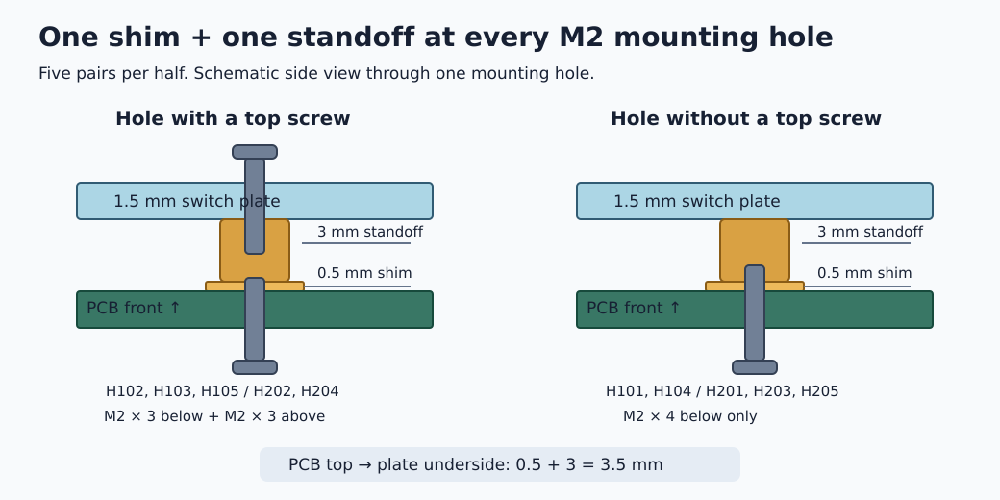
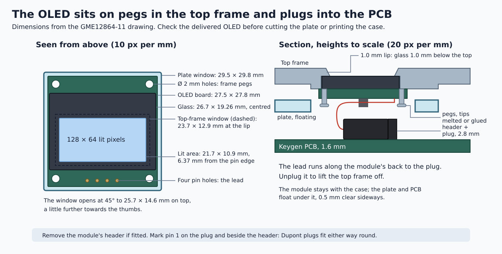
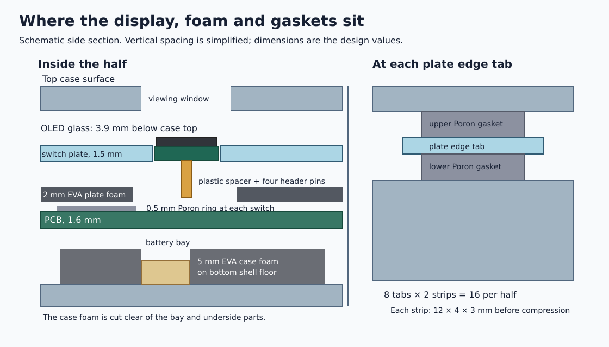

# Keygen build guide

How to build Keygen from nothing: the parts, the order to get them in, then soldering, flashing and
closing the case. Every part is hand-soldered. Read the parts list and [The plan](#the-plan) first:
some parts are made to fit others, so the order of things matters.

## Parts list

Counts are for the whole keyboard (two halves). Stores, links, prices and spares are in the
[shopping checklist](bom/CHECKLIST.md); the specs are in the [parts list](plan/bom.html).

### Electronics

| Part | Count | Remarks |
| :--- | :---: | :--- |
| Keygen PCB, left and right | 1 + 1 | Bare boards, black mask. Order settings in [`fab/ORDER.md`](fab/ORDER.md) |
| nRF52840 SuperMini | 2 | A nice!nano v2 clone, socketed on the back |
| Round-hole female header + machined male pins | 4 rows of 12 each | The controller's sockets, cut from 1×40 strips |
| SK6812MINI-E LED | 66 | Reverse-mount, one per key. The fiddliest part: buy spares |
| 1N4148 diode, DO-35 | 68 | 34 per half: one per key and one for each encoder's push switch |
| Kailh hotswap socket (CPG151101S11) | 66 | |
| AO3401A P-MOSFET, SOT-23 | 4 | The battery switch and the LED power switch |
| AO3400A N-MOSFET, SOT-23 | 2 | The LED power switch |
| 1 MΩ resistor, 1206 | 2 | |
| 100 kΩ resistor, 1206 | 4 | |
| 10 µF and 100 nF capacitors, 1206 | 2 + 2 | |
| MSK12C02 slide switch | 2 | The power switch |
| 6 × 6 × 5 mm tact switch | 2 | The reset button |
| JST-PH side-entry connector (S2B-PH-K-S) | 2 | For the battery |
| EC11 encoder with switch, 20 mm D shaft | 2 | |
| 0.96 in. I2C OLED, pins GND VCC SCL SDA | 2 | Some modules swap GND and VCC: don't use those |
| 1×4 right-angle male pin header, 2.54 mm | 2 | Soldered into J101 / J201; cut from a 1×40 strip |
| Female–female jumper wire, 2.54 mm | 8 | Four per OLED, their plug ends glued into one 4-pin plug; the other ends are cut off and soldered to the OLED |
| LiPo 505080 (5 × 50 × 80 mm), JST-PH lead | 2 | With a protection board |
| JST-PH 2.0 plug with 10 cm wires, 2-pin | 2 | For a battery without a JST-PH plug: solder its leads to the plug's wires and heat-shrink each joint |

### Switches, keycaps and knobs

| Part | Count | Remarks |
| :--- | :---: | :--- |
| Akko V3 Lavender Purple Pro switch, 5-pin | 66 | |
| DSA keycap, 1u | 52 | Blank PBT, smoke translucent |
| DSA keycap, 1.25u | 14 | |
| Aluminium knob, 17 × 13 mm, 6 mm D bore | 2 | |

### Plate, case and foam

| Part | Count | Remarks |
| :--- | :---: | :--- |
| Switch plate, 1.5 mm clear polycarbonate | 1 + 1 | CNC-routed, see [Order and make the parts](#order-and-make-the-parts) |
| Case, PETG: bottom shell and top frame | 2 + 2 | 3D-printed |
| Poron ring switch pad, 0.5 mm | 66 | |
| EVA foam: 2 mm plate foam, 5 mm case foam | 2 + 2 pieces | Cut from A4 sheets; the plate foam is taped under the plate |
| Poron gasket strip, 12 × 4 × 3 mm | 32 pieces | Cut from 80 × 4 × 3 mm strips |
| M2 × 3 mm brass standoff, female-female | 10 | |
| M2 shim, 2 × 5 × 0.5 mm (DIN 988) | 10 | |
| M2 × 5 mm button-head screw (ISO 7380) | 10 | Up through the PCB into the standoffs |
| M2 × 3 mm heat-set insert, 3.5 mm OD | 16 | |
| M2 × 16 mm socket-head screw (ISO 4762) | 16 | |

### Feet and tenting

| Part | Count | Remarks |
| :--- | :---: | :--- |
| Silicone bumper, 8 × 3 mm | 16 | 8 without the wedges |
| Round steel plate, 40 mm, self-adhesive | 2 | Sits flush in a pocket in each floor |
| 3D-printed tenting wedge | 2 | Optional |
| Neodymium disc magnet, 10 × 3 mm | 8 | For the wedges |
| Superglue | 1 | For the wedges |
| USB-A to 2 × USB-C cable | 1 | Optional: both halves from one port |

## Tools

- A temperature-controlled soldering iron with a fine tip (300–350 °C; 320 °C for the LEDs)
- Solder, no-clean flux paste in a syringe, desoldering wick
- Flush cutters and fine tweezers
- A multimeter: continuity, polarity, battery voltage, and current for the charge check
- Calipers, for the OLED module and the controller sockets
- Kapton tape
- Isopropyl alcohol (90 % or more) and an old toothbrush, for flux residue
- A magnifier, for the LED and SOT-23 joints
- A USB-C cable and a computer, to flash and test
- A 1.3 mm hex key (button heads), a 1.5 mm hex key (case screws), and an iron tip or heat-set tool
  for the inserts
- Thin double-sided tape for the battery: tissue tape, 0.3 mm or less, not foam tape
- A keycap and switch puller
- A craft knife and a steel ruler, to cut the foam by hand

## Introduction

### What you are building

Two halves, built the same way. Each is a stack, from the bottom: a 3D-printed bottom shell with the
battery and a foam layer in it; the PCB, with most parts on its underside; foam pads; a clear polycarbonate switch plate on five
standoffs, holding the switches, with a foam sheet taped under it; and a 3D-printed
top frame over it all, screwed to the bottom shell. The plate-and-PCB unit rests on small foam
strips (gaskets) between the shell and the frame, so it floats.

### What goes where

Everything sits on the back of the PCB except the switches, the encoder and the OLED. The right
half is the left half mirrored.

### Words used here

- **Front** is the switch side of the PCB. **Back** is the other side: it has two large pads per key
  for the hotswap sockets.
- **Left and right.** The left half's parts are numbered 1xx and the right half's 2xx: Q101 on the
  left is Q201 on the right. Below, the left reference comes first. To tell the bare boards apart,
  lay them front up: the left half has its encoder and OLED holes along its right-hand (inner) edge,
  the right half along its left-hand edge.
- **Through-hole** parts have legs that go through the board; you solder them on the opposite side
  and trim the legs. **Surface-mount (SMD)** parts sit on pads on one side.
- **References** (Q101, D107, H102) name each part's place on the board. The silkscreen is artwork
  and prints only a few of them; the assembly maps show all of them.

### Assembly maps

Each map shows one side of one half with every part's reference and pad numbers. The back maps are
drawn as the board lies when you turn it over, so they match what you see. Find each part on its map
before you solder it.

| Half | Back | Front |
|---|---|---|
| Left | [`assembly-left-back.png`](https://github.com/milindmadhukar/keygen/releases/download/media/assembly-left-back.png) | [`assembly-left-front.png`](https://github.com/milindmadhukar/keygen/releases/download/media/assembly-left-front.png) |
| Right | [`assembly-right-back.png`](https://github.com/milindmadhukar/keygen/releases/download/media/assembly-right-back.png) | [`assembly-right-front.png`](https://github.com/milindmadhukar/keygen/releases/download/media/assembly-right-front.png) |

The power parts beside each controller, enlarged:

## The plan

Most things can be ordered on day one. Two parts are made to fit parts you buy, so they wait until
those have arrived and been measured: the switch plate (with its foam) waits for the OLED modules,
and the case (with its foam) for the controller sockets and the OLED modules. Soldering needs neither, so the boards can
be built and tested while the plate and the case are being made.

| When | Do | Waiting for |
|---|---|---|
| Day one | Print the fit test. Order the PCBs and every part above, including the polycarbonate sheet and the EVA foam | Nothing. The parts shipped from abroad and the PCBs take longest: order them first |
| The OLED modules have arrived | Measure one, then have the plates cut and cut the plate foam | The plate's OLED window is sized for a module of 27.5 × 28 mm or less |
| The controller sockets and OLED modules have arrived | Measure both, then print the case and cut the case foam | The case's USB-C opening is placed from the socket height, and the top frame holds the OLED's glass in a pocket |
| The PCBs and the electronics have arrived | Solder and test both boards, from [Inspect the board](#inspect-the-board) to [Encoder and matrix test](#encoder-and-matrix-test) | Nothing more |
| The plates and the plate foam are ready | [Standoffs](#standoffs) to [Switches](#switches) | |
| The case and the case foam are ready | [Heat-set inserts](#heat-set-inserts) to [Feet and tenting](#feet-and-tenting) | |

Every file to order, print or cut is in the [build release](https://github.com/milindmadhukar/keygen/releases/tag/build).
Cut and print everything from the same release, so the plate, the foam and the case match.

## Order and make the parts

### Fit test

Print [`keygen-plate-print.pdf`](https://github.com/milindmadhukar/keygen/releases/download/build/keygen-plate-print.pdf)
at 100 % ("actual size") on A4 and measure the 100 mm ruler on it: if it is not exactly 100 mm,
reprint. Rest your hands on it and check the thumb cluster and the knob positions.

### PCBs

Two orders of 5, one per half: [`keygen-left-gerbers.zip`](https://github.com/milindmadhukar/keygen/releases/download/build/keygen-left-gerbers.zip) and
[`keygen-right-gerbers.zip`](https://github.com/milindmadhukar/keygen/releases/download/build/keygen-right-gerbers.zip), bare boards, black mask. The
order-form settings and what to check in the fab's design check (DFM) report are in
[`fab/ORDER.md`](fab/ORDER.md).

### When the parts arrive

- **OLED modules:** the pin order printed on the module is GND, VCC, SCL, SDA.
- **Batteries:** each cell has a protection board (a small circuit board under the tape at the lead
  end). The controller has no over-discharge cut-off; fit a DW01A module to a cell without one.
- **Battery connectors:** the side-entry type (S2B-PH-K-S), whose opening faces sideways, not up.
- **Encoders:** a D-shaped (half-round) shaft, to match the knob, 20 mm long from the top of the
  encoder's body (its tip 26.5 mm above the body's base).
- **Knobs:** measure one with calipers: **A**, from its bottom edge up to the inside of its top,
  where the shaft stops; and **B**, how far its plastic hub's bottom face is set up inside from the
  bottom edge. The case assumes A = 11.0 and B = 2.0 mm. Set `KNOB_DEPTH` and `KNOB_HUB_UP` in
  [`tools/case_geometry.py`](tools/case_geometry.py) to what you measure and run `tools/regen.py`:
  it works out how high the knob sits and how much to cut off the shaft (`ENC_SHAFT_CUT`, printed
  by `python3 tools/case_geometry.py`). The case itself doesn't change.
- **Encoder shafts:** cut them now, before soldering, so no filings get into the board. Uncut,
  the 20 mm shaft would hold the knob 6.5 mm off the deck and 9 mm above the keys. With A = 11.0
  and B = 2.0 mm, cut **2.4 mm** off the tip, leaving **24.1 mm** from the bottom of the encoder's
  body. Wrap the body in tape, hold the shaft in pliers so the cut doesn't turn the encoder, cut
  with a fine hacksaw or a cutting disc, and file the end flat with a small chamfer. Push a knob on
  to check it bottoms on the shaft and turns without wobble.

### Switch plates

**When:** once the OLED modules have arrived. The plate's window and the top frame's OLED mount
follow the module's drawing ([GME12864-11](https://robu.in/wp-content/uploads/2019/12/GME12864-11.pdf), p. 5):
a **27.5 × 27.8 × 1.2 mm** board with four **Ø 2.0 mm holes** 2.0 mm in from each edge, its pins
1.5 mm from one edge, a **26.7 × 19.26 mm glass panel** 4.27 mm in from both the pin edge and the
far edge, and a **21.744 × 10.864 mm lit area** 6.37 mm from the pin edge. The CAD takes the glass
and its tape as **1.6 mm** thick. Measure these with calipers before cutting the plates or printing
the case, especially the height from the board's face to the glass top. If the delivered module
differs, update the `OLED_*` values in [`tools/case_geometry.py`](tools/case_geometry.py) and run
`tools/regen.py` (see [Building from source](notes/17%20-%20building%20from%20source.md)) before
using the generated plate, case or foam files.

Then have both halves CNC-routed (not laser-cut) from the 1.5 mm clear polycarbonate sheet with
[`keygen-plate-left.dxf`](https://github.com/milindmadhukar/keygen/releases/download/build/keygen-plate-left.dxf) and
[`keygen-plate-right.dxf`](https://github.com/milindmadhukar/keygen/releases/download/build/keygen-plate-right.dxf), as
[`PLATE.md`](case/plate/PLATE.md#routing-the-plates-from-polycarbonate-sheet) describes. Or order
the same plate in FR-4 from a PCB fab: [`keygen-plate-left-gerbers.zip`](https://github.com/milindmadhukar/keygen/releases/download/build/keygen-plate-left-gerbers.zip) and
[`keygen-plate-right-gerbers.zip`](https://github.com/milindmadhukar/keygen/releases/download/build/keygen-plate-right-gerbers.zip), with the
settings in [`PLATE.md`](case/plate/PLATE.md).

### Foam

**When:** the plate foam with the plates, the case foam with the case. Neither is installed until the
board is soldered, so they can be cut while you solder. The plate foam is taped to the underside of
the plate; see [Switch pads and plate foam](#switch-pads-and-plate-foam).

The [build release](https://github.com/milindmadhukar/keygen/releases/tag/build) has these four
**different** 1:1 DXFs, all in millimetres. Send each file with its material and thickness to the
laser cutter; each is seen from above:

| Cut file | Material | Location |
|---|---|---|
| [`keygen-left-plate-foam.dxf`](https://github.com/milindmadhukar/keygen/releases/download/build/keygen-left-plate-foam.dxf) | 2 mm EVA | Taped under the left switch plate |
| [`keygen-right-plate-foam.dxf`](https://github.com/milindmadhukar/keygen/releases/download/build/keygen-right-plate-foam.dxf) | 2 mm EVA | Taped under the right switch plate |
| [`keygen-left-case-foam.dxf`](https://github.com/milindmadhukar/keygen/releases/download/build/keygen-left-case-foam.dxf) | 5 mm EVA | Left bottom-shell floor |
| [`keygen-right-case-foam.dxf`](https://github.com/milindmadhukar/keygen/releases/download/build/keygen-right-case-foam.dxf) | 5 mm EVA | Right bottom-shell floor |

The matching SVGs have the same names with `.svg` and physical millimetre dimensions. To cut by
hand, print the SVG at
100 % as for the fit test, tape it to the sheet and cut along the lines with a sharp craft knife and
a steel ruler. Keep each piece the right way up as drawn: they are seen from above and are not
symmetrical. Cut only the two EVA sheets per half from these files. The 120-piece Poron ring pack is
already cut: use 33 rings per half (66 total), one round each switch. The separate Poron gasket
strips are cut across their length into 12 mm pieces: 16 per half, one below and one above each of
the plate's eight edge tabs. **Do not laser-cut the polycarbonate switch plate**; its DXF is a
separate CNC router job.

### Case

**When:** once the controller sockets and the OLED modules have arrived. Measure the height of a
female socket strip's plastic body with calipers. If it is not 3.0 mm, set `SOCKET_H` in
[`tools/gen_schematic.py`](tools/gen_schematic.py) and run `tools/regen.py` before printing. Check
the OLED module as in [Switch plates](#switch-plates): the top frame holds its glass.

Print [`keygen-left-bottom.stl`](https://github.com/milindmadhukar/keygen/releases/download/build/keygen-left-bottom.stl),
[`keygen-right-bottom.stl`](https://github.com/milindmadhukar/keygen/releases/download/build/keygen-right-bottom.stl),
[`keygen-left-top.stl`](https://github.com/milindmadhukar/keygen/releases/download/build/keygen-left-top.stl) and
[`keygen-right-top.stl`](https://github.com/milindmadhukar/keygen/releases/download/build/keygen-right-top.stl)
in PETG at 0.2 mm layers and 90 % infill, dense for weight and a deeper sound: the bottom shells
floor-down and the top frames deck-down, without supports (the 40 mm pocket for the steel disc in
each floor is bridged). A printing service can print from the same settings.

The tenting wedges are optional and can come later:
[`keygen-left-wedge.stl`](https://github.com/milindmadhukar/keygen/releases/download/build/keygen-left-wedge.stl)
and [`keygen-right-wedge.stl`](https://github.com/milindmadhukar/keygen/releases/download/build/keygen-right-wedge.stl),
in PETG at 0.2 mm layers and 20 % infill, top face down as the STLs lie, without supports.

> [!NOTE]
> The fits are close: 1.0 mm from the plate edge to the wall, 0.5 mm round each gasket tab.
> Calibrate the printer's flow and dimensions first, and try the plate in each bottom shell before
> setting the inserts: sand a tight wall or pocket, don't force the plate.

---

## Inspect the board

- Tell the front from the back and the left half from the right ([Words used here](#words-used-here)).
- Check that the 33 LED cut-outs are milled cleanly and nothing is bridged.
- With the multimeter, check there is no short between B+, the LED rail and GND.

> [!WARNING]
> Keep the battery unplugged whenever you solder. Clean off flux with isopropyl alcohol as you go.

For every small surface-mount part below: tin one pad, hold the part in place with tweezers while you
reheat that pad, solder the other pads, then touch up the first.

---

## Battery switch

On the back, beside the controller's footprint (see the enlarged power map above).

- AO3401A P-MOSFET **Q101 / Q201**, between the controller and the power switch.
- 1 MΩ resistor **R101 / R201**, below it.
- MSK12C02 slide switch **SW190 / SW290**, at the top edge.

---

## LED power switch

- AO3401A P-MOSFET **Q102 / Q202** and AO3400A N-MOSFET **Q103 / Q203**, between the battery
  connector and the board edge.
- 100 kΩ resistors **R102, R103 / R202, R203**, below each MOSFET.
- 10 µF capacitor **C101 / C201** and 100 nF capacitor **C102 / C202**, beside the switch.

> [!WARNING]
> The two MOSFET types look alike, and ceramic capacitors carry no marking. Keep each in its labelled
> bag and take it out only as you place it.

---

## Battery connector and reset button

Both are through-hole: place them on the back and solder them on the front.

- JST-PH side-entry connector **BT101 / BT201**, turned to match its outline on the map.
- 6 mm reset button **SW191 / SW291**, the one labelled GENERATE.

---

## Controller

The controller (**U101 / U201**) plugs into sockets on the back, so it can be swapped. It sits
upside down compared with most keyboards: chip and USB-C away from the PCB.

1. Before soldering, check the SuperMini with the multimeter: **B+** (pad 13), **GND** and **VCC**
   (pad 16).
2. Cut two 12-pin lengths of the female socket strip and two of the round male pins. Push the socket
   strips into the footprint from the back, push the male pins into the sockets, and lay the
   controller on the pins.
3. Seat the controller with its chip and USB-C facing away from the PCB, the USB-C end at the
   board's top edge (the map marks it USB).
4. Solder the pins to the controller, then turn the board over and solder the socket strips on the
   front. Soldering everything in place keeps the pins lined up. Lift the controller out and check
   every joint.
5. Check that the USB-C end lines up with the board's top edge, overhanging it by 1 mm.

> [!WARNING]
> Seated chip-side down, the pinout is mirrored and the battery lands on a GPIO.

---

## Bring-up

1. Flash the firmware (see [Flashing](#flashing)) and check that the half shows up over USB.
2. **Protection board.** Check the cell has one. Fit a DW01A module to a cell without one.
3. **Battery polarity.** With the multimeter, confirm the red wire lands on the PCB's **+** pad
   before plugging in. Swap the crimps if it does not.
4. Plug the battery in and check that the slide switch turns the half on and off. Leave the switch
   on while charging.
5. **Charge current.** With the multimeter in series with the battery and USB plugged in, confirm
   about 100 mA. An empty 2500 mAh cell takes roughly a day.
6. **Lead length.** Measure the battery lead from the pouch to the end of the plug. It runs about
   50 mm in the case, from the bay to **BT101 / BT201**; with less than about 80 mm, plug it in
   before taping the cell down (see [Battery](#battery)).

> [!WARNING]
> JST-PH packs come wired both ways round, and a reversed battery kills the controller. Check the
> polarity every time, and unplug the battery again before you solder anything else.

---

## LEDs

SK6812MINI-E **LED101–LED133 / LED201–LED233**, reverse-mount: placed on the back, upside down, with
the lit side down through the cut-out so it shines out of the front.

- The LED's cut corner marks its GND pin. Turn it so that corner sits on pad 1.
- Iron at 320 °C, plenty of flux, 2–3 seconds per pad. Tin one pad, place the LED in its cut-out,
  reheat the tinned pad, then solder the other three. Kapton tape keeps the neighbouring pads clean.
- Solder them in number order, six or so at a time, then plug in USB and check they light before
  going on. Use SYS + `A` to toggle the lighting. Measure the LED rail and battery current with USB
  disconnected: the pinned ZMK ext-power driver starts enabled, so a dark strip may still draw power.

> [!NOTE]
> Data passes from LED to LED in number order, LED101 first, so one bad joint darkens every LED
> after it. That is why you test as you go.

---

## Diodes

1N4148 **D101–D134 / D201–D234**, body on the back. **D107 / D207** is the encoder's, beside it.

- Band towards the square pad, marked K on the maps.
- Bend the leads to the footprint spacing, insert, splay the legs, solder on the front, and trim the
  legs flush so nothing touches a switch. Keep the joints on the front low: the switch pads stick
  down over them.

---

## Hotswap sockets

Kailh sockets on the back, one per switch position (33).

Tack one pad while holding the socket flat, solder the other pad fully, then finish the first. Use
plenty of solder: both joints should be concave, as the socket takes the force of every switch
insertion.

---

## Encoder and matrix test

EC11 encoder **ENC101 / ENC201** on the **front**.

1. Solder all five pins and both mounting tabs on the back.
2. Short each socket's two contacts with tweezers and check that the key registers (ZMK Studio on the
   left half, or a key tester such as [keyboard-test.space](https://keyboard-test.space)).
3. Turn and press the encoder. Left: scroll and middle click. Right: volume and mute.

The board is done. The rest waits for the plates, the foam and the case.

---

## Standoffs

The five mounting holes on each PCB are **H101–H105** on the left and **H201–H205** on the right.
Find them on the [front assembly maps](#assembly-maps); they are the five plain M2 holes, separate
from the switch holes. Put **one 0.5 mm shim and one M2 × 3 mm female-female standoff at every one**
of these holes (five pairs per half, ten pairs total). Both sit on the **front/switch side of the
PCB**, inside the space between PCB and plate. They do not go on the case or its gasket tabs.

At each hole, stack the parts in this order, from bottom to top: screw head against the **back of
the PCB** → PCB → 0.5 mm shim centred on the hole → 3 mm standoff → underside of the switch
plate. Drive an **M2 × 5 button-head screw** upward through the PCB and shim into the standoff. The
shim plus standoff make the required **3.5 mm gap between the PCB top and plate underside**; with
the 1.5 mm plate, its top is 5.0 mm above the PCB top. That gap is set by the MX switch: its housing
reaches from the plate down to the PCB while its posts and contacts enter the PCB's holes.

The same screw goes in at all ten holes, and **nothing screws into the standoffs from above**. The
M2 × 5 fills 2.9 mm of the 3 mm standoff, about seven turns of thread, so it holds firmly. Its tip
ends 0.1 mm below the standoff's top; a screw at the long end of its tolerance pokes up to 0.1 mm
into the plate's 2.2 mm hole, where it touches nothing. The standoff tops only bear on the plate
from below. The plate and PCB are held together by the 33 switches per half, each clipped into the
plate and plugged into its hotswap socket, and the closed case clamps the plate's tabs between the
gasket strips. No screw goes from the PCB or plate into the case; the eight longer case screws join
the bottom shell to the top frame around the edge.

Hold the standoff with your fingers and turn the screw with a small screwdriver until it stops,
then a little more: snug, not hard. The shim must not spin and the standoff must not rock.

---

## Switch pads and plate foam

1. Stick a 0.5 mm Poron ring switch pad on the front of the PCB round each switch position (33), its
   notches facing the switch's clips (top and bottom) and its open middle round the pins and the LED
   window. Where a ring's corner meets a standoff (7 rings per half), snip that corner off first.
   Where a ring crosses a diode's two joints, snip a notch in it so it lies flat on the board.
2. Tape the 2 mm EVA plate foam to the **underside of the switch plate** with the thin
   double-sided tape (tissue tape, not foam tape), a few strips across the sheet. The cut file is
   drawn seen from above, which is how it lies under the plate too: line its cut-outs up with the
   plate's switch, encoder and OLED cut-outs and its round holes with the plate's standoff holes.
   The small notches in each switch cut-out are for the switch's latches, which spring out under
   the plate: keep them clear, or the switches will not clip in.
   In the 3.5 mm gap the stack is then **0.5 mm Poron on the PCB, 1.0 mm air, 2.0 mm EVA on the
   plate**. The EVA touches the plate, so it damps it, and it does not press on the PCB, so it
   does not push the plate and PCB apart.

---

## Plate and OLED

1. Set the plate, foam side down, on the standoffs. It is not screwed down: line its standoff
   holes up over the standoffs and it rests on them. The switches will clip it to the PCB.
2. Check that the pin order printed on the OLED module is GND, VCC, SCL, SDA, the same as the
   footprint. Some modules swap GND and VCC: don't use those.
3. The module sits in the top frame, not on the PCB, and plugs into **J101 / J201** on a short lead,
   so the top frame can come off. Solder a **1×4 right-angle male header** into J101 / J201 from
   the front, its pins lying flat and pointing **away from the thumb keys**, under where the module
   will be. Solder it on the back and trim the pins flush there: the battery lead runs under them.
4. If the module came with a header soldered on, remove it: clip the plastic bar off with flush
   cutters, then heat each pin and pull it out with tweezers, and clear the holes with solder wick.
5. Take four female–female jumper wires, ideally four colours. Line their plug ends up side by
   side, in GND, VCC, SCL, SDA order, and glue the four housings together with a thin smear of
   superglue on their sides (keep it off the openings): they become one 4-pin plug that can only
   go on in that order. Cut the wires **45 mm** from the plug and strip 2 mm. Push them into the
   module's four holes **from its back** (the side without the glass) and solder them on the glass
   side, each to its own pin: hold the plug over the header the way it will go on and match GND to
   GND. Trim the joints to 1 mm or less; the top frame has a 1.5 mm relief over them. Lay the wires
   flat along the module's back, between its parts, towards its far edge, and hold them there with
   a strip of Kapton tape. The plug is not keyed and fits the header either way round, so mark
   pin 1 (GND) on it and beside the header with a paint pen.
6. Push the plug onto the header and power the half: check the status screen appears. Until the
   case is closed the module hangs on its lead; don't let it rest on the board while powered.

The module is mounted in [Top frame](#top-frame). Its glass sits in a pocket under a 1.0 mm lip
round the window, **1.0 mm below the top surface**, and the window's edges are chamfered at 45°.
The lip window is 23.7 × 12.9 mm, 1 mm round the lit area, and 25.7 × 14.6 mm at the top, opening
further towards the thumbs. Under it the header and plug lie flat, 2.8 mm tall, 1.2 mm below the
parts on the module's back (0.2 mm with the plate floated fully up); the module clears the floating plate's window by
0.5 mm all round. To take the top frame off later, lift it at the OLED end and pull the plug off
the header.

> [!WARNING]
> A module with GND and VCC swapped is powered backwards. Check the printed order before soldering.

---

## Switches

- Before fitting all 66, dry-fit one actual Akko switch through the plate into a socketed PCB.
  Check that both housing clips catch the 1.5 mm plate, the switch bottom sits flat on the PCB,
  the centre post and two plastic locating pins enter their PCB holes, and both metal contacts
  enter the hotswap socket on the back. Plug the board in and check that the key registers. The
  PCB footprint has five holes per switch: a 3.9878 mm centre hole, two 1.75 mm locating holes,
  and two 3.0 mm holes for the socket contacts. The plate has a 14 × 14 mm opening aligned with
  each footprint. This geometry follows the [Cherry MX mounting drawing](https://www.farnell.com/datasheets/1792245.pdf)
  and Akko calls this a [5-pin switch](https://en.akkogear.com/product/akko-v3-lavender-purple-pro-switch-45pcs/),
  but Akko does not publish a dimensioned pin-length drawing for this specific switch, so the dry
  fit is the final check before assembly.
- Check each remaining switch's pins are straight, then press it through the plate into its socket
  while supporting the PCB behind the socket with your other hand. The switch pins are not soldered.
- The two tall 1.25u thumb switches per half are turned 90°.

---

## Heat-set inserts

Lay the top frame deck-down and press the 8 M2 heat-set inserts into the blind holes in its underside
at about 200–230 °C, flush with the surface and no deeper (1.7 mm of frame covers each hole). Let
them cool.

---

## Battery

- Tape the pouch into the bay in the bottom shell's floor with thin double-sided tape, its lead end
  towards the battery connector. With a short lead (see [Bring-up](#bring-up)), plug it into
  **BT101 / BT201** first, holding the plate-and-PCB unit on its edge beside the shell, then lay the
  cell in its bay.
- Check the installed cell, protection board and tape before closing: the 1.0 mm gap at full gasket
  travel allows a 6.1 mm battery stack (5.0 mm cell, 0.3 mm thickness tolerance, 0.5 mm swelling and
  0.3 mm tape) and underside parts no taller than 2.0 mm. Excess solder or a thicker stack uses that
  gap.

> [!WARNING]
> Never press, fold or puncture the pouch.

---

## Case foam

Lay the 5 mm EVA case foam on the floor of the bottom shell, round the battery in its bay and clear
of the controller, connector, switch, reset tube, encoder and OLED pins. It goes **below the PCB**;
it does not bridge the battery bay or touch the solder joints.

---

## Plate-and-PCB unit

1. Cut the Poron strips into 12 mm pieces and put one on each of the 8 gasket ledges, pushed to the
   ledge's outer end.
2. Plug the battery lead into **BT101 / BT201**, leaving it a loose loop: the unit floats, and a tight
   lead holds it down on one side.
3. Lower the unit onto the strips, the controller's end down into its pocket behind the USB-C port
   and the slide switch in its opening. Hold the unit away from the top edge as it goes down: the
   switch lever clears that wall by only 0.2 mm.
4. Press the plate down near each tab: it should sink evenly on the strips and spring back, with
   nothing under it (the lead, a strip off its ledge) pressing on it or holding it.
5. Put a second piece on top of each plate tab.

---

## Top frame

1. Mount the OLED module in the top frame. Unplug its lead from the header. Peel the protective
   film off the glass. Lay the top frame face down, underside up, and lower the module glass-down
   onto the **four pegs** round its pocket, one through each of its corner holes: the glass drops
   into the pocket under the lip and the board sits flat on the frame. Check from the front that
   the lit area is centred in the window.
2. Fix it on the pegs. Either melt each peg's tip with the soldering iron (about 220 °C): touch it
   for a second or two and press it flat into a rivet head over the board, or put a small dab of
   hot glue over each peg's tip. Keep heat and glue off the glass and away from the flex cable
   that wraps round the far edge. The module must not move when pressed from the front.
3. Plug the lead back onto the header, pin 1 to pin 1, and fit the top frame, the lead and plug
   lying flat under the module. Look through the window: the module should not have shifted.
4. Holding the two parts together, turn the half over onto a soft cloth and drive the 8 M2 × 16
   screws up through the floor's counterbores evenly, a little at a time: snug, not tight, so the
   gaskets stay soft. The closed half should not rattle when shaken, and the plate should give a
   little when pressed in the middle; if it rattles, a strip has fallen off its ledge.

---

## Keycaps, knob and final test

1. Fit the keycaps: per half, 26 × 1u and 7 × 1.25u (the two tall thumb caps turned 90°).
2. Push a knob onto each encoder shaft (cut short in
   [When the parts arrive](#when-the-parts-arrive)) until the shaft stops inside it. Its underside
   now sits **4.1 mm above the deck**: it clears the deck with the plate pressed down and the knob
   clicked, and its top stands 6.7 mm above the keycaps. Press it: it should click without touching the deck.
3. Turn both halves on together so they pair with each other, then pair the host to Bluetooth
   profile 1 (SYS + `1`: hold both 1.25u thumb keys and press `1`).
4. Test every key on every layer, both encoders, both OLEDs, the LEDs on USB, and the link between
   the halves on battery. The keymap is in [`firmware/README.md`](firmware/README.md#keymap).

---

## Feet and tenting

1. **Rubber feet.** Stick four 8 mm silicone bumpers on the floor, centred about 7 mm in from the
   edges: at the outer bottom corner and the tip under the thumb cluster, and at the outer and inner
   top corners with their centres 17 mm below the top edge. Lower than that, the outer top foot
   covers a screw counterbore, and the inner one the USB-C opening. Keep each one clear of the
   counterbores and the reset pinhole.
2. **Steel disc.** Press a 40 mm round steel plate, adhesive side down, into the round pocket in the
   floor. It sits flush, like the screw heads.
3. **Wedges (optional).** Try the half on its wedge first: each foot must drop into its 12 mm recess
   in the wedge's top face. Then put a drop of superglue in each of the four 10 mm pockets and press
   in a magnet until it bottoms, one at a time and away from the others so they don't jump together.
   Let the glue cure with the half off the wedge. Stick four bumpers on the wedge's flat underside,
   near its corners.
4. **Tenting.** Set the half on its wedge, thick side towards the middle of the desk. Its feet drop
   into the recesses and the magnets hold the disc. Lift it off to lay the half flat on its feet, or
   to reach the reset pinhole.

---

## Flashing

The firmware is three UF2 files: `keygen_left`, `keygen_right` and `settings_reset`. To get them,
open the [Firmware workflow](https://github.com/milindmadhukar/keygen/actions/workflows/firmware.yml)
on GitHub, pick the latest successful run, and download its `keygen-firmware` artifact (this needs a
GitHub account); unzip it. Artifacts expire after 90 days. Or build them yourself with
`firmware/build.sh` ([`firmware/README.md`](firmware/README.md#building)).

1. Plug the half in over USB-C.
2. **Double-press the reset button** (GENERATE). In the case, press it through the pinhole in the
   floor. A drive called `NICENANO` appears.
3. Copy `keygen_left-nice_nano.uf2` to the left half, or `keygen_right-nice_nano.uf2` to the right.
   The drive disconnects when it is done.

Once the firmware is running, SYS + `B` (left) or SYS + `N` (right) also enters the bootloader. If the
halves do not pair, flash `settings_reset-nice_nano.uf2` to both, then the normal firmware again.

## Troubleshooting

| Symptom | Check |
|---|---|
| Half not detected over USB | Another cable and port. Controller seated chip-out and fully in its sockets. No short between the LED rail and GND. A double-press of reset still brings up the bootloader |
| Half does not run on battery | Red wire on the **+** pad. Battery above 3.0 V. Slide switch on. Q101 / Q201 and R101 / R201 soldered |
| One key does not work | Switch fully seated, pins straight. Diode present and the right way round. Socket joints. Continuity from the socket to the controller pin |
| Several keys register at once | A diode missing or reversed, or a short between a row and a column |
| LEDs dark from one point on | The first dark LED or the one before it: a bad joint, or turned the wrong way. Data from P0.06 reaching the first LED. The LED rail at battery voltage while the LEDs are on; if not, the LED power switch (Q102/Q103, R102/R103) and P0.08. SYS + `A` toggles the strip; check its rail voltage, not its visible state alone |
| OLED blank | Module pin order against the footprint (GND, VCC, SCL, SDA). 3.3 V on VCC, switched on through P0.13. SDA on P0.17, SCL on P0.20, address 0x3C. The screen blanks when idle: press a key |
| Halves do not connect | Both halves on and charged. Flash `settings_reset` to both, then the normal firmware |

Common mistakes: a diode backwards, a battery plugged in reversed, the controller seated upside down,
bent switch pins, cold (dull or grainy) joints, and overtightened screws, which crack the PCB or the
screw bosses.
