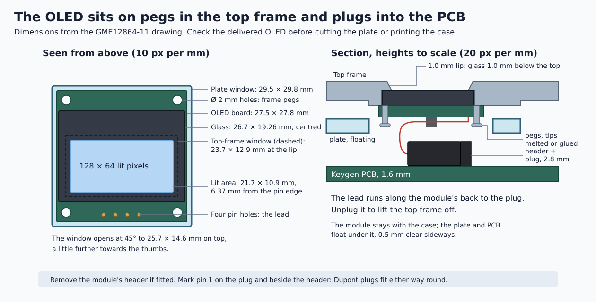
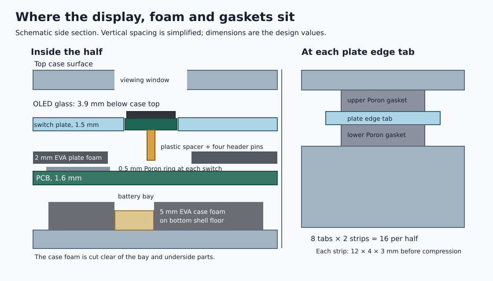
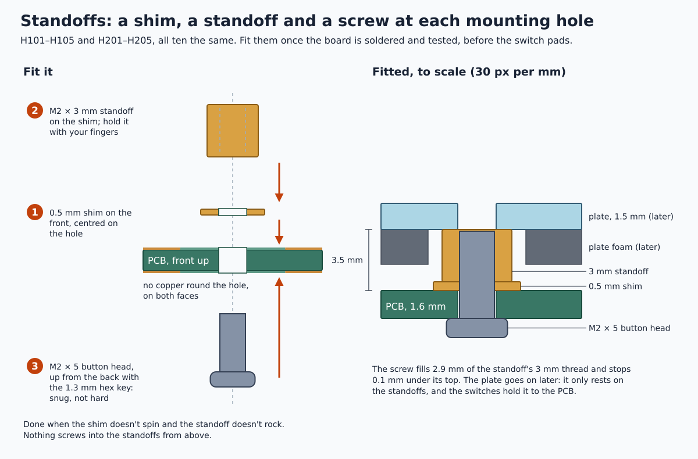
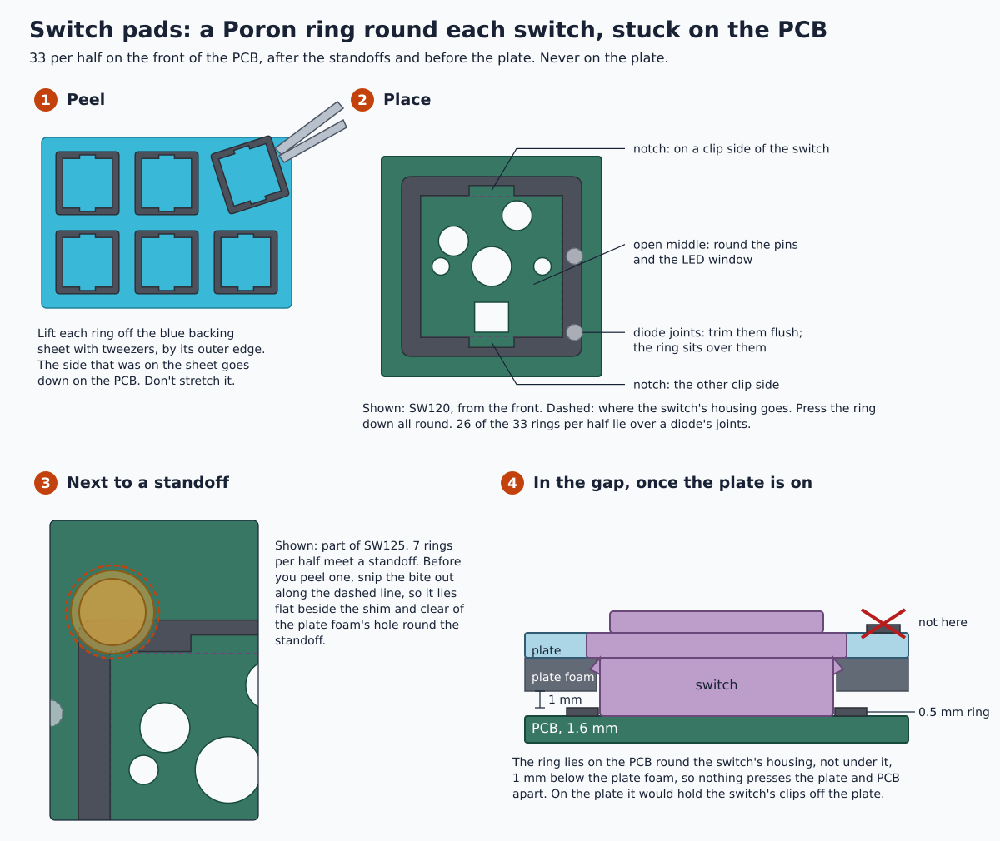
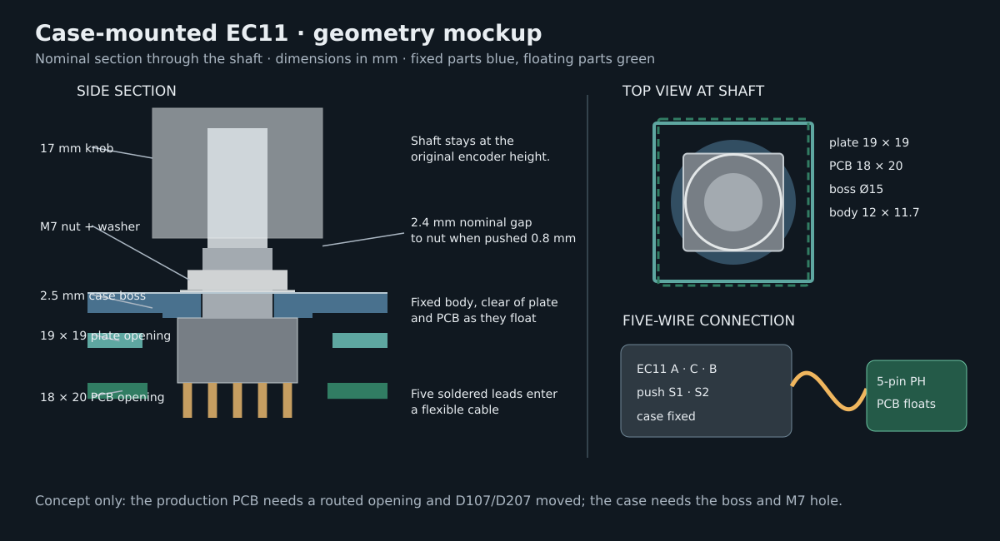

# Keygen build guide

How to build Keygen from nothing: the parts, the order to get them in, then soldering, flashing and
closing the case. Every part is hand-soldered. Read the parts list and [The plan](#the-plan) first:
some parts are made to fit others, so the order of things matters.

## Parts list

Counts are for the whole keyboard (two halves). Stores, links, prices and spares are in the
[shopping checklist](bom/CHECKLIST.md); the specs are in the [parts list](plan/bom.html).

### Electronics

| Part | Count | Remarks |
| :--- | :---: | :--- |
| Keygen PCB, left and right | 1 + 1 | Bare boards, black mask. Order settings in [`fab/ORDER.md`](fab/ORDER.md) |
| nRF52840 SuperMini | 2 | A nice!nano v2 clone, socketed on the back |
| Round-hole female header + machined male pins | 4 rows of 12 each | The controller's sockets, cut from 1×40 strips |
| SK6812MINI-E LED | 66 | Reverse-mount, one per key. The fiddliest part: buy spares |
| 1N4148W diode, SOD-123 | 68 | 34 per half: one per key and one for each encoder's push switch |
| Kailh hotswap socket (CPG151101S11) | 66 | |
| AO3401A P-MOSFET, SOT-23 | 2 | The battery switch |
| 1 MΩ resistor, 1206 | 2 | |
| TPS61023 boost converter, SOT-563 | 2 | The LED boost. 0.5 mm pitch |
| 1 µH inductor, 1210 (TDK TMS322512ALM-1R0MTAA) | 2 | For the boost |
| 22 µF capacitor, 16 V X7R, 1206 | 4 | The boost's output |
| 10 µF capacitor, 1206 | 4 | The boost's input and the last LED |
| 732 kΩ and 100 kΩ resistors, 1 %, 1206 | 2 + 4 | The boost's feedback divider and enable pull-down |
| SN74LV1T125 buffer, SOT-23-5 | 2 | The LED data buffer |
| 330 Ω resistor, 0805 | 2 | Beside the first LED |
| 100 nF capacitor, 0805 | 2 | At the buffers. The 66 footprints beside the LEDs are optional |
| SK12D07VG5 right-angle slide switch | 2 | The power switch |
| 6 × 6 × 5 mm tact switch | 2 | The reset button |
| JST-PH side-entry connector (S2B-PH-K-S) | 2 | For the battery |
| EC11 encoder with switch, 20 mm D shaft | 2 | |
| 1×5 right-angle male pin header, 2.54 mm | 2 | Cut from the OLED's header strip |
| Female–female jumper wires | 10 | Five per half, for the encoder |
| 0.96 in. I2C OLED, pins GND VCC SCL SDA | 2 | Some modules swap GND and VCC: don't use those |
| 1×4 right-angle male pin header, 2.54 mm | 2 | Soldered into J101 / J201; cut from a 1×40 strip |
| Female–female jumper wire, 2.54 mm | 8 | Four per OLED, their plug ends glued into one 4-pin plug; the other ends are cut off and soldered to the OLED |
| LiPo KP-355085 (3.5 × 50 × 85 mm) | 2 | With a protection board |
| JST-PH 2.0 plug with 10 cm wires, 2-pin | 2 | For a battery without a JST-PH plug: solder its leads to the plug's wires and heat-shrink each joint |

### Switches, keycaps and knobs

| Part | Count | Remarks |
| :--- | :---: | :--- |
| Akko V3 Lavender Purple Pro switch, 5-pin | 66 | |
| DSA keycap, 1u | 52 | Blank PBT, smoke translucent |
| DSA keycap, 1.25u | 14 | |
| Aluminium knob, 17 × 13 mm, 6 mm D bore | 2 | |

### Plate, case and foam

| Part | Count | Remarks |
| :--- | :---: | :--- |
| Switch plate, 1.5 mm clear polycarbonate | 1 + 1 | CNC-routed, see [Order and make the parts](#order-and-make-the-parts) |
| Case, PETG: bottom shell and top frame | 2 + 2 | 3D-printed |
| Poron ring switch pad, 0.5 mm | 66 | Ready-cut rings on a backing sheet, pack of 120; stuck on the PCB round each switch |
| EVA foam: 2 mm plate foam, 5 mm case foam | 2 + 2 pieces | Cut from A4 sheets; the plate foam is taped under the plate |
| Poron gasket strip, 12 × 4 × 3 mm | 32 pieces | Cut from 80 × 4 × 3 mm strips |
| M2 × 3 mm brass standoff, female-female | 10 | On the PCB's front, one per mounting hole |
| M2 shim, 2 × 5 × 0.5 mm (DIN 988) | 10 | Under each standoff |
| M2 × 5 mm button-head screw (ISO 7380) | 10 | Up through the PCB into the standoffs |
| M2 × 3 mm heat-set insert, 3.5 mm OD | 16 | |
| M2 × 16 mm socket-head screw (ISO 4762) | 16 | |

### Feet and tenting

| Part | Count | Remarks |
| :--- | :---: | :--- |
| Silicone bumper, 8 × 3 mm | 16 | 8 without the wedges |
| Round steel plate, 40 mm, self-adhesive | 2 | Sits flush in a pocket in each floor |
| 3D-printed tenting wedge | 2 | Optional |
| Neodymium disc magnet, 10 × 3 mm, N35 | 8 | For the wedges |
| USB-A to 2 × USB-C cable | 1 | Optional: both halves from one port |

## Tools

- A temperature-controlled soldering iron with a fine tip (300–350 °C; 320 °C for the LEDs)
- Solder, no-clean flux paste in a syringe, desoldering wick, heat-shrink tubing
- Superglue, for the OLED plug and the wedge magnets, and a paint pen
- Flush cutters, fine tweezers, and small sharp scissors for the switch pads
- A multimeter: continuity, polarity, battery voltage, and current for the charge check
- Calipers, for the OLED module, the controller sockets and their pins
- A fine hacksaw or cutting disc, pliers and a small file, to cut the encoder shafts
- Kapton tape
- Isopropyl alcohol (90 % or more) and an old toothbrush, for flux residue
- A magnifier, for the LED and SOT-23 joints
- A USB-C cable and a computer, to flash and test
- A 1.3 mm hex key (button heads), a 1.5 mm hex key (case screws), and an iron tip or heat-set tool
  for the inserts
- Hot glue, if you would rather not melt the OLED's pegs
- Thin double-sided tape for the battery and the plate foam: tissue tape, 0.3 mm or less, not foam tape
- A keycap and switch puller
- A craft knife and a steel ruler, to cut the foam by hand

## Introduction

### What you are building

Two halves, built the same way. Each is a stack, from the bottom: a 3D-printed bottom shell with the
battery and a foam layer in it; the PCB, with most parts on its underside, a foam ring stuck round
each switch and five brass standoffs screwed to it; a clear polycarbonate switch plate resting on the
standoffs, holding the switches, with a foam sheet taped under it; and a 3D-printed
top frame over it all, screwed to the bottom shell. The plate-and-PCB unit rests on small foam
strips (gaskets) between the shell and the frame, so it floats.

### What goes where

Everything sits on the back of the PCB except the switches and the OLED header. The encoder and
the OLED module are held in the top frame and plug into the PCB. The right half is the left half
mirrored.

### Words used here

- **Front** is the switch side of the PCB. **Back** is the other side: it has two large pads per key
  for the hotswap sockets.
- **Left and right.** The left half's parts are numbered 1xx and the right half's 2xx: Q101 on the
  left is Q201 on the right. Below, the left reference comes first. To tell the bare boards apart,
  lay them front up: the left half has its encoder opening and OLED holes along its right-hand
  (inner) edge, the right half along its left-hand edge.
- **Through-hole** parts have legs that go through the board; you solder them on the opposite side
  and trim the legs. **Surface-mount (SMD)** parts sit on pads on one side.
- **References** (Q101, D107, H102) name each part's place on the board. The silkscreen is artwork
  and prints only a few of them; the assembly maps show all of them.

### Assembly maps

Each map shows one side of one half with every part's reference and pad numbers. The back maps are
drawn as the board lies when you turn it over, so they match what you see. Find each part on its map
before you solder it.

The same maps, at full size, are in the printed reference,
[`keygen-reference.pdf`](https://github.com/milindmadhukar/keygen/releases/download/build/keygen-reference.pdf):
each half's key layout and the back of the board at 1:1, the power parts and each part type close
up, the keymap, the key matrix and the parts lists to tick off, on A4 in black and white. Print it at
100 % ("Actual size") and check its 100 mm ruler.

| Half | Back | Front |
|---|---|---|
| Left | [`assembly-left-back.png`](https://github.com/milindmadhukar/keygen/releases/download/media/assembly-left-back.png) | [`assembly-left-front.png`](https://github.com/milindmadhukar/keygen/releases/download/media/assembly-left-front.png) |
| Right | [`assembly-right-back.png`](https://github.com/milindmadhukar/keygen/releases/download/media/assembly-right-back.png) | [`assembly-right-front.png`](https://github.com/milindmadhukar/keygen/releases/download/media/assembly-right-front.png) |

The power parts beside each controller, enlarged:

## The plan

Most things can be ordered on day one. Two parts are made to fit parts you buy, so they wait until
those have arrived and been measured: the switch plate (with its foam) waits for the OLED modules,
and the case (with its foam) for the controller sockets, their pins and the OLED modules. Soldering needs neither, so the boards can
be built and tested while the plate and the case are being made.

| When | Do | Waiting for |
|---|---|---|
| Day one | Print the fit test. Order the PCBs and every part above, including the polycarbonate sheet and the EVA foam | Nothing. The parts shipped from abroad and the PCBs take longest: order them first |
| The OLED modules have arrived | Measure one, then have the plates cut and cut the plate foam | The plate's OLED window is sized for a module of 27.5 × 28 mm or less |
| The controller sockets, their pins and the OLED modules have arrived | Measure them, then print the case and cut the case foam | The case's floor and USB-C opening are placed from the height of the socket and pin stack, and the top frame holds the OLED's glass in a pocket |
| The PCBs and the electronics have arrived | Solder and test both boards, from [Inspect the board](#inspect-the-board) to [Encoder and matrix test](#encoder-and-matrix-test) | Nothing more |
| The boards are tested, and the OLED modules, standoffs and switch pads have arrived | [OLED header and lead](#oled-header-and-lead), [Standoffs](#standoffs) and [Switch pads](#switch-pads) | Nothing: none of them needs the plate |
| The plates and the plate foam are ready | [Plate foam and plate](#plate-foam-and-plate) and [Switches](#switches) | |
| The case and the case foam are ready | [Heat-set inserts](#heat-set-inserts) to [Feet and tenting](#feet-and-tenting), including [the encoder](#encoder-in-the-top-frame) | |

Every file to order, print or cut is in the [build release](https://github.com/milindmadhukar/keygen/releases/tag/build).
Cut and print everything from the same release, so the plate, the foam and the case match.

## Order and make the parts

### Fit test

Print [`keygen-plate-print.pdf`](https://github.com/milindmadhukar/keygen/releases/download/build/keygen-plate-print.pdf)
at 100 % ("actual size") on A4 and measure the 100 mm ruler on it: if it is not exactly 100 mm,
reprint. Rest your hands on it and check the thumb cluster and the knob positions.

### PCBs

Two orders of 5, one per half: [`keygen-left-gerbers.zip`](https://github.com/milindmadhukar/keygen/releases/download/build/keygen-left-gerbers.zip) and
[`keygen-right-gerbers.zip`](https://github.com/milindmadhukar/keygen/releases/download/build/keygen-right-gerbers.zip), bare boards, black mask. The
order-form settings and what to check in the fab's design check (DFM) report are in
[`fab/ORDER.md`](fab/ORDER.md).

### When the parts arrive

- **OLED modules:** the pin order printed on the module is GND, VCC, SCL, SDA.
- **Batteries:** each cell has a protection board (a small circuit board under the tape at the lead
  end). The controller has no over-discharge cut-off; fit a DW01A module to a cell without one.
- **Battery connectors:** the side-entry type (S2B-PH-K-S), whose opening faces sideways, not up.
- **Encoders:** a D-shaped (half-round) shaft, to match the knob, 20 mm long from the top of the
  encoder's body (its tip 26.5 mm above the body's base).
- **Knobs:** measure one with calipers: **A**, from its bottom edge up to the inside of its top,
  where the shaft stops; and **B**, how far its plastic hub's bottom face is set up inside from the
  bottom edge. The case assumes A = 11.0 and B = 2.0 mm. Set `KNOB_DEPTH` and `KNOB_HUB_UP` in
  [`tools/case_geometry.py`](tools/case_geometry.py) to what you measure and run `tools/regen.py`:
  it works out how high the knob sits and how much to cut off the shaft (`ENC_SHAFT_CUT`, printed
  by `python3 tools/case_geometry.py`). The case itself doesn't change.
- **Encoder shafts:** with A = 11.0 and B = 2.0 mm the shaft is cut by **1.0 mm**. Print the
  [test coupon](docs/encoder-mount.md#test-coupon) first, and dry-fit the delivered encoder, washer,
  nut and knob on it **before cutting**: the knob's D bore must land on the shaft's flat, with the
  knob clear of the nut when pushed. Then cut: tape the body against filings, hold the shaft so it
  cannot turn in the encoder, cut with a fine hacksaw or disc, file the end flat with a small
  chamfer, and dry-fit the knob again.

### Switch plates

**When:** once the OLED modules have arrived. The plate's window and the top frame's OLED mount
follow the module's drawing ([GME12864-11](https://robu.in/wp-content/uploads/2019/12/GME12864-11.pdf), p. 5):
a **27.5 × 27.8 × 1.2 mm** board with four **Ø 2.0 mm holes** 2.0 mm in from each edge, its pins
1.5 mm from one edge, a **26.7 × 19.26 mm glass panel** 4.27 mm in from both the pin edge and the
far edge, and a **21.744 × 10.864 mm lit area** 6.37 mm from the pin edge. The CAD takes the glass
and its tape as **1.6 mm** thick. Measure these with calipers before cutting the plates or printing
the case, especially the height from the board's face to the glass top. If the delivered module
differs, update the `OLED_*` values in [`tools/case_geometry.py`](tools/case_geometry.py) and run
`tools/regen.py` (see [Building from source](notes/17%20-%20building%20from%20source.md)) before
using the generated plate, case or foam files.

Then have both halves CNC-routed (not laser-cut) from the 1.5 mm clear polycarbonate sheet with
[`keygen-plate-left.dxf`](https://github.com/milindmadhukar/keygen/releases/download/build/keygen-plate-left.dxf) and
[`keygen-plate-right.dxf`](https://github.com/milindmadhukar/keygen/releases/download/build/keygen-plate-right.dxf), as
[`PLATE.md`](case/plate/PLATE.md#routing-the-plates-from-polycarbonate-sheet) describes. Or order
the same plate in FR-4 from a PCB fab: [`keygen-plate-left-gerbers.zip`](https://github.com/milindmadhukar/keygen/releases/download/build/keygen-plate-left-gerbers.zip) and
[`keygen-plate-right-gerbers.zip`](https://github.com/milindmadhukar/keygen/releases/download/build/keygen-plate-right-gerbers.zip), with the
settings in [`PLATE.md`](case/plate/PLATE.md).

### Foam

**When:** the plate foam with the plates, the case foam with the case. Neither is installed until the
board is soldered, so they can be cut while you solder. The plate foam is taped to the underside of
the plate; see [Plate foam and plate](#plate-foam-and-plate).

The [build release](https://github.com/milindmadhukar/keygen/releases/tag/build) has these four
**different** 1:1 DXFs, all in millimetres. Send each file with its material and thickness to the
laser cutter; each is seen from above:

| Cut file | Material | Location |
|---|---|---|
| [`keygen-left-plate-foam.dxf`](https://github.com/milindmadhukar/keygen/releases/download/build/keygen-left-plate-foam.dxf) | 2 mm EVA | Taped under the left switch plate |
| [`keygen-right-plate-foam.dxf`](https://github.com/milindmadhukar/keygen/releases/download/build/keygen-right-plate-foam.dxf) | 2 mm EVA | Taped under the right switch plate |
| [`keygen-left-case-foam.dxf`](https://github.com/milindmadhukar/keygen/releases/download/build/keygen-left-case-foam.dxf) | 5 mm EVA | Left bottom-shell floor |
| [`keygen-right-case-foam.dxf`](https://github.com/milindmadhukar/keygen/releases/download/build/keygen-right-case-foam.dxf) | 5 mm EVA | Right bottom-shell floor |

The matching SVGs have the same names with `.svg` and physical millimetre dimensions. To cut by
hand, print the SVG at
100 % as for the fit test, tape it to the sheet and cut along the lines with a sharp craft knife and
a steel ruler. Keep each piece the right way up as drawn: they are seen from above and are not
symmetrical. Cut only the two EVA sheets per half from these files. The 120-piece Poron ring pack is
already cut: use 33 rings per half (66 total), one round each switch on the PCB (see
[Switch pads](#switch-pads)). The separate Poron gasket
strips are cut across their length into 12 mm pieces: 16 per half, one below and one above each of
the plate's eight edge tabs. **Do not laser-cut the polycarbonate switch plate**; its DXF is a
separate CNC router job.

### Case

**When:** once the controller sockets, their pins and the OLED modules have arrived. With calipers,
measure the plastic body of a female socket strip and the plastic carrier of the male pin strip,
then push the pins into the socket and measure the two together: the controller rests on top of
that stack. If they are not 3.0 mm and 1.9 mm, set `SOCKET_H` and `PIN_CARRIER_H` in
[`tools/gen_schematic.py`](tools/gen_schematic.py) and run `tools/regen.py` before printing. Check
the OLED module as in [Switch plates](#switch-plates): the top frame holds its glass.

Print [`keygen-left-bottom.stl`](https://github.com/milindmadhukar/keygen/releases/download/build/keygen-left-bottom.stl),
[`keygen-right-bottom.stl`](https://github.com/milindmadhukar/keygen/releases/download/build/keygen-right-bottom.stl),
[`keygen-left-top.stl`](https://github.com/milindmadhukar/keygen/releases/download/build/keygen-left-top.stl) and
[`keygen-right-top.stl`](https://github.com/milindmadhukar/keygen/releases/download/build/keygen-right-top.stl)
in PETG at 0.2 mm layers and 90 % infill, dense for weight and a deeper sound: the bottom shells
floor-down and the top frames deck-down, without supports (the 40 mm pocket for the steel disc in
each floor is bridged). A printing service can print from the same settings.

The tenting wedges are optional and can come later:
[`keygen-left-wedge.stl`](https://github.com/milindmadhukar/keygen/releases/download/build/keygen-left-wedge.stl)
and [`keygen-right-wedge.stl`](https://github.com/milindmadhukar/keygen/releases/download/build/keygen-right-wedge.stl),
in PETG at 0.2 mm layers and 20 % infill, top face down as the STLs lie, without supports. Their
magnet pockets are printed against the bed: if a magnet won't go in, sand the mouth rather than
forcing it.

> [!NOTE]
> The fits are close: 1.0 mm from the plate edge to the wall, 0.5 mm round each gasket tab.
> Calibrate the printer's flow and dimensions first, and try the plate in each bottom shell before
> setting the inserts: sand a tight wall or pocket, don't force the plate. Check the floor's disc
> pocket too: its roof is a 40 mm bridge, and a disc that stands proud of it needs the sag scraped
> flat.

---

## Inspect the board

- Tell the front from the back and the left half from the right ([Words used here](#words-used-here)).
- Check that the 33 LED cut-outs are milled cleanly and nothing is bridged.
- With the multimeter, check there is no short between B+, the LED rail, the boost's SW node and GND.

> [!WARNING]
> Keep the battery unplugged whenever you solder. Clean off flux with isopropyl alcohol as you go.

For every small surface-mount part below: tin one pad, hold the part in place with tweezers while you
reheat that pad, solder the other pads, then touch up the first.

---

## Battery switch

On the back, beside the controller's footprint (see the enlarged power map above).

- AO3401A P-MOSFET **Q101 / Q201**, between the controller and the power switch.
- 1 MΩ resistor **R101 / R201**, below it.

The power switch beside them is through-hole: it goes on with the battery connector.

---

## LED boost and data buffer

The LED boost, on the back between the battery connector and the board edge (on the right half the
group is turned half a turn and sits higher):

- TPS61023 boost **U102 / U202**. Its pins are 0.5 mm apart, and its pads reach 0.6 mm past the
  leads for the iron: flux the pads, tin one corner pad, place the part with pin 1 on the
  footprint's mark, then touch each lead's pad tip with a fine tip, or reflow it with hot air.
  Check for bridges under a loupe; wick removes one.
- 1 µH inductor **L101 / L201**, beside it.
- 22 µF capacitors **C101, C104 / C201, C204** and 10 µF capacitor **C103 / C203**.
- 732 kΩ resistor **R102 / R202** and 100 kΩ resistor **R104 / R204**, the feedback divider beside
  it, and 100 kΩ resistor **R103 / R203** below it (above it on the right half).

The data buffer and the LED capacitors:

- SN74LV1T125 buffer **U103 / U203**, its 100 nF capacitor **C102 / C202** and the 330 Ω resistor
  **R105 / R205**, beside the first LED (LED101 / LED201).
- 10 µF capacitor **C105 / C205**, beside the last LED.
- The footprints beside each LED (**C111–C143 / C211–C243**) stay empty. Fit 100 nF in a few of
  them only if the chain glitches on a full-white step.

> [!WARNING]
> Ceramic capacitors carry no marking. Keep each value in its labelled bag and take it out only as
> you place it.

---

## Battery connector, reset button and power switch

All three are through-hole: place them on the back and solder them on the front.

- JST-PH side-entry connector **BT101 / BT201**, turned to match its outline on the map.
- 6 mm reset button **SW191 / SW291**, the one labelled GENERATE.
- SK12D07VG5 slide switch **SW190 / SW290**, at the top edge, its body flat on the board and its knob
  out over the edge. Solder the three pins and the two mounting tabs, then trim them flush on the
  front. Pad 3 is unconnected.

---

## Controller

The controller (**U101 / U201**) plugs into sockets on the back, so it can be swapped. It sits
upside down compared with most keyboards: chip and USB-C away from the PCB.

1. Before soldering, check the SuperMini with the multimeter: **B+** (pad 13), **GND** and **VCC**
   (pad 16). On USB, VCC must read 3.3 V: some SuperMini batches have no 3.3 V regulator and put
   about 4.7 V there, which would overdrive the OLED's lines. Check `INFO_UF2.TXT` on its drive
   shows a nice!nano-compatible bootloader. Then bridge its **BOOST** link, the two pads of the unfitted 0 Ω link on its back, with a
   solder blob or a 0 Ω resistor: the charger then charges at about 300 mA.
2. Cut two 12-pin lengths of the female socket strip and two of the round male pins. Push the socket
   strips into the footprint from the back, push the male pins into the sockets, and lay the
   controller on the pins.
3. Seat the controller with its chip and USB-C facing away from the PCB, the USB-C end at the
   board's top edge (the map marks it USB).
4. Solder the pins to the controller, then turn the board over and solder the socket strips on the
   front. Soldering everything in place keeps the pins lined up. Lift the controller out and check
   every joint.
5. Check that the USB-C end lines up with the board's top edge, overhanging it by 1 mm.

Keep the pins' plastic carrier on: it stays between the socket and the controller.

> [!WARNING]
> Seated chip-side down, the pinout is mirrored and the battery lands on a GPIO.

---

## Bring-up

1. Flash the firmware (see [Flashing](#flashing)) and check that the half shows up over USB.
2. **Protection board.** Check the cell has one. Fit a DW01A module to a cell without one.
3. **Battery polarity.** With the multimeter, confirm the red wire lands on the PCB's **+** pad
   before plugging in. Swap the crimps if it does not.
4. Plug the battery in and check that the slide switch turns the half on and off. Leave the switch
   on while charging. The switch doesn't protect against a reversed cell: off, the battery MOSFET's
   body diode still conducts, so check the polarity even with it off.
5. **LED supply, before any LED goes on.** Flash the LED test build (`keygen_left-led-test` or
   `keygen_right-led-test`, see [Flashing](#flashing)), plug in the battery and USB, and measure the
   LED rail at C101 / C201 against GND: 4.83–5.08 V. Above that, the boost's feedback resistor
   R102 / R202 has a bad joint and the rail would sit at 5.5–6 V, past the LEDs' rating: fix it first.
6. **Charge current.** With the multimeter in series with the battery and USB plugged in, confirm
   about 300 mA. An empty cell takes about ten hours. With no battery fitted, the keys, OLED and
   Bluetooth run from USB, but the lighting has no supply.
7. **Lead length.** Measure the battery lead from the pouch to the end of the plug. It runs about
   50 mm in the case, from the bay to **BT101 / BT201**; with less than about 80 mm, plug it in
   before taping the cell down (see [Battery](#battery)).

> [!WARNING]
> JST-PH packs come wired both ways round, and a reversed battery kills the controller. Check the
> polarity every time, and unplug the battery again before you solder anything else.

---

## LEDs

SK6812MINI-E **LED101–LED133 / LED201–LED233**, reverse-mount: placed on the back, upside down, with
the lit side down through the cut-out so it shines out of the front.

- The LED's cut corner marks its GND pin. Turn it so that corner sits on pad 1.
- Iron at 320 °C, plenty of flux, 2–3 seconds per pad. Tin one pad, place the LED in its cut-out,
  reheat the tinned pad, then solder the other three. Kapton tape keeps the neighbouring pads clean.
- Solder them in number order, six or so at a time, with the battery unplugged. Then, with the LED
  test build on the controller, plug in the battery and USB: the half lights every LED it has on its
  own, so each new one should light before you go on. Unplug the battery again before soldering.
- When all 33 are on, flash the normal build. Then the lighting follows SYS + `A`, and on battery
  stays off until SYS + `Z` allows it. Check the LED rail reads about 4.95 V with the lighting on
  and near 0 V with it off, on USB and on battery.
- The first time the lighting turns on, the boost charges its capacitors in a burst. If a half
  resets at that moment on a low cell, charge the cell and report it.

> [!NOTE]
> Data passes from LED to LED in number order, LED101 first, so one bad joint darkens every LED
> after it. That is why you test as you go.

---

## Diodes

1N4148W **D101–D134 / D201–D234**, SOD-123, on the back. **D107 / D207** is the encoder's, beside
its opening.

- The band (cathode) goes towards pad 1, the end with the silkscreen bar.
- Tin pad 1. Hold the diode on its pads with tweezers, band towards pad 1, and touch the tinned pad
  to tack it. Solder pad 2, then go back over pad 1. Nothing comes through to the front.

---

## Hotswap sockets

Kailh sockets on the back, one per switch position (33).

Tack one pad while holding the socket flat, solder the other pad fully, then finish the first. Use
plenty of solder: both joints should be concave, as the socket takes the force of every switch
insertion.

---

## Encoder and matrix test

A 1×5 right-angle header in **J102 / J202** on the **back**, beside the encoder opening.

1. Cut a 1×5 piece from the right-angle header strip. Solder it into J102 / J202 from the back,
   its pins lying flat and pointing **away from the thumb keys**, and trim the pins flush on the
   front.
2. Take five female–female jumper wires and glue their plug ends side by side into one 5-pin plug
   with a thin smear of superglue, as for the OLED. Cut the wires **100 mm** from the plug, strip
   2 mm, and solder each to its encoder terminal with heat-shrink over each joint:

   | J102 / J202 pin | Encoder terminal | Net |
   | :---: | :---: | :--- |
   | 1, the square pad at the outer end | A | `ENC_A` |
   | 2 | C, the middle pin of the three | `GND` |
   | 3 | B | `ENC_B` |
   | 4 | S1 | `COL6` |
   | 5 | S2 | `K06`, to the diode |

   The plug is not keyed: mark pin 1 on it and beside the header with a paint pen. Check each wire
   with the meter from the plug to its terminal: A and B swapped only reverses the rotation, but C,
   S1 or S2 in the wrong place makes the encoder dead.
3. Plug the lead in. Short each socket's two contacts with tweezers and check that the key registers
   (ZMK Studio on the left half, or a key tester such as
   [keyboard-test.space](https://keyboard-test.space)).
4. Turn and press the encoder. Left: scroll and middle click. Right: volume and mute.
5. Unplug the lead.

The board is soldered and tested. The OLED header, the standoffs and the switch pads come next; none
of them needs the plate, so they can go on while the plates are being cut.

---

## OLED header and lead

**When:** once the board passes the tests above and the OLED modules have arrived. This is the
last soldering on the board, so do it before the switch pads go on: a hot iron melts the rings.

1. Check that the pin order printed on the OLED module is GND, VCC, SCL, SDA, the same as the
   footprint. Some modules swap GND and VCC: don't use those.
2. The module sits in the top frame, not on the PCB, and plugs into **J101 / J201** on a short lead,
   so the top frame can come off. Solder a **1×4 right-angle male header** into J101 / J201 from
   the front, its pins lying flat and pointing **away from the thumb keys**, under where the module
   will be. Solder it on the back and trim the pins flush there: the battery lead runs under them.
3. Under the plug's path the front of the board has six socket tails (**U101 pads 7–12 / U201 pads
   19–24**) and **BT101 / BT201 pad 2**. Trim them flush and keep those joints low, then try a
   plug on the header: it must lie flat. If it still rides up, leave the plug and the header out
   and solder the four wires straight into J101 / J201, with enough slack to lay the top frame
   beside the half.
4. If the module came with a header soldered on, remove it: clip the plastic bar off with flush
   cutters, then heat each pin and pull it out with tweezers, and clear the holes with solder wick.
5. Take four female–female jumper wires, ideally four colours. Line their plug ends up side by
   side, in GND, VCC, SCL, SDA order, and glue the four housings together with a thin smear of
   superglue on their sides (keep it off the openings): they become one 4-pin plug that can only
   go on in that order. Cut the wires **45 mm** from the plug and strip 2 mm. Push them into the
   module's four holes **from its back** (the side without the glass) and solder them on the glass
   side, each to its own pin: hold the plug over the header the way it will go on and match GND to
   GND. Trim the joints to 1 mm or less; the top frame has a 1.5 mm relief over them. Lay the wires
   flat along the module's back, between its parts, towards its far edge, and hold them there with
   a strip of Kapton tape. The plug is not keyed and fits the header either way round, so mark
   pin 1 (GND) on it and beside the header with a paint pen.
6. Push the plug onto the header and power the half: check the status screen appears. Until the
   case is closed the module hangs on its lead; don't let it rest on the board while powered.
   Unplug it again before the next steps.

The module is mounted in [Top frame](#top-frame). Its glass sits in a pocket under a 1.0 mm lip
round the window, **1.0 mm below the top surface**, and the window's edges are chamfered at 45°.
The lip window is 23.7 × 12.9 mm, 1 mm round the lit area, and 25.7 × 14.6 mm at the top, opening
further towards the thumbs. Under it the header and plug lie flat, 2.8 mm tall, 1.2 mm below the
parts on the module's back (0.2 mm with the plate floated fully up); the module clears the floating plate's window by
0.5 mm all round. To take the top frame off later, lift it at the OLED end, pull the plug off
the header, then lift the plate-and-PCB unit out with the frame to reach J102 / J202 on its back.

> [!WARNING]
> A module with GND and VCC swapped is powered backwards. Check the printed order before soldering.

---

## Standoffs

**When:** after [OLED header and lead](#oled-header-and-lead), with all the soldering done and
tested. They go on before the switch pads, which are snipped round them, and before the plate,
which rests on them.

**Per half:** five 0.5 mm shims, five M2 × 3 mm female-female standoffs, five M2 × 5 button-head
screws, and the 1.3 mm hex key.

1. Find the five mounting holes, **H101–H105** on the left and **H201–H205** on the right, on the
   [front assembly maps](#assembly-maps): the plain 2.2 mm holes with bare board round them, apart
   from the switch holes.
2. Lay the board front up, near the edge of the bench so you can reach under it. Put a shim on the
   first hole, centred, and stand a standoff on the shim.
3. Hold the standoff down with a finger. From the back, push a screw up through the hole and the
   shim into the standoff and turn it a few times by hand.
4. Tighten it with the hex key until it stops, then a little more: snug, not hard. The shim must not
   spin and the standoff must not rock.
5. Do the other four holes the same way, then the other half.

Every hole gets the same three parts, and **nothing screws into the standoffs from above**. The
shim and standoff make the **3.5 mm gap between the PCB's top and the plate's underside** that the
MX switches are made for, so the plate's top is 5.0 mm above the PCB's. The M2 × 5 fills 2.9 mm of
the standoff's thread, about seven turns, and its tip stops 0.1 mm under the standoff's top. The
plate only rests on the standoffs: the 33 switches per half, clipped into the plate and plugged into
their sockets, hold it to the PCB, and the closed case clamps its tabs between the gasket strips.
No screw goes from the PCB or the plate into the case.

---

## Switch pads

**When:** straight after the standoffs, before the plate. The board must be finished: no more
soldering on it once the rings are on.

**Where:** on the **front of the PCB**, one ring round each switch position, 33 per half. Never on
the plate: a ring there sits between the switch and the plate, and the switch's clips no longer
catch the plate.

**Per half:** 33 rings from the 120-piece pack (the PORON option, 0.5 mm), fine tweezers, and small
sharp scissors.

1. Wipe the front of the board with isopropyl alcohol where the rings go and let it dry: flux
   residue stops them sticking.
2. Lift a ring off the blue backing sheet with the tweezers, gripping its outer edge. The side
   that was on the sheet is the side that goes down. Don't stretch it.
3. Hold it over a switch position before it touches the board. Line it up: its open middle round
   the five switch holes and the LED window, and its two notches at the top and bottom of the
   opening, the sides the switch's clips are on. Lower it and press it down all round with a
   fingertip.
4. On 7 positions per half, a corner of the ring meets a standoff's shim. Hold the ring over its
   place first, see where it would ride up on the shim, and snip that bite out with the scissors,
   just clear of the shim. Then stick it down beside the shim, flat.
5. Check before going on: no ring lies on a shim, a switch hole or an LED window, and no two
   overlap.

If a batch comes without adhesive, lay the rings in place dry: the switches and the plate foam hold
them there.

---

## Plate foam and plate

**When:** once the plates and the plate foam are cut, and the switch pads are on.

1. Tape the 2 mm EVA plate foam to the **underside of the switch plate** with the thin
   double-sided tape (tissue tape, not foam tape), a few strips across the sheet. The cut file is
   drawn seen from above, which is how it lies under the plate too: line its cut-outs up with the
   plate's switch, encoder and OLED cut-outs and its round holes with the plate's standoff holes.
   The small notches in each switch cut-out are for the switch's latches, which spring out under
   the plate: keep them clear, or the switches will not clip in.
2. Set the plate, foam side down, on the standoffs. It is not screwed down: line its standoff
   holes up over the standoffs and it rests on them. The switches will clip it to the PCB.

In the 3.5 mm gap the stack is then **0.5 mm Poron on the PCB, 1.0 mm air, 2.0 mm EVA on the
plate**. The EVA touches the plate, so it damps it, and it does not press on the PCB, so it does
not push the plate and PCB apart.

---

## Switches

- Before fitting all 66, dry-fit one actual Akko switch through the plate into a socketed PCB.
  Check that both housing clips catch the 1.5 mm plate, the switch bottom sits flat on the PCB,
  the centre post and two plastic locating pins enter their PCB holes, and both metal contacts
  enter the hotswap socket on the back. Plug the board in and check that the key registers. The
  PCB footprint has five holes per switch: a 3.9878 mm centre hole, two 1.75 mm locating holes,
  and two 3.0 mm holes for the socket contacts. The plate has a 14 × 14 mm opening aligned with
  each footprint. This geometry follows the [Cherry MX mounting drawing](https://www.farnell.com/datasheets/1792245.pdf)
  and Akko calls this a [5-pin switch](https://en.akkogear.com/product/akko-v3-lavender-purple-pro-switch-45pcs/),
  but Akko does not publish a dimensioned pin-length drawing for this specific switch, so the dry
  fit is the final check before assembly.
- Check each remaining switch's pins are straight, then press it through the plate into its socket
  while supporting the PCB behind the socket with your other hand. The switch pins are not soldered.
- The two tall 1.25u thumb switches per half are turned 90°.
- Check deep sleep while the battery lead can still reach a multimeter. Build the firmware with
  `CONFIG_ZMK_IDLE_SLEEP_TIMEOUT=60000` in [`firmware/keygen.conf`](firmware/keygen.conf), then with
  the OLED plugged in, USB disconnected and the meter in series with the battery, leave the half
  alone for a minute. The LED rail should be near zero and the battery current in the tens to low
  hundreds of µA, with the encoder at rest in a few positions. A key press wakes the half; turning
  the encoder does not. Flash the normal firmware afterwards.

---

## Heat-set inserts

Lay the top frame deck-down and press the 8 M2 heat-set inserts into the blind holes in its underside
at about 230–245 °C, flush with the surface and no deeper (1.7 mm of frame covers each hole). Let
them cool.

---

## Battery

- Tape the pouch into the bay in the bottom shell's floor with thin double-sided tape, its lead end
  towards the battery connector. With a short lead (see [Bring-up](#bring-up)), plug it into
  **BT101 / BT201** first, holding the plate-and-PCB unit on its edge beside the shell, then lay the
  cell in its bay.
- Check the installed cell, protection board and tape before closing: the 2.9 mm gap at full gasket
  travel allows a 6.1 mm battery stack (5.0 mm cell, 0.3 mm thickness tolerance, 0.5 mm swelling and
  0.3 mm tape) and underside parts no taller than 2.0 mm. Excess solder or a thicker stack uses that
  gap.

> [!WARNING]
> Never press, fold or puncture the pouch.

---

## Case foam

Lay the 5 mm EVA case foam on the floor of the bottom shell, round the battery in its bay and clear
of the controller, connector, switch, reset tube and OLED pins. Its opening by the encoder is the
bay for the encoder's terminals, its lead and J102 / J202. It goes **below the PCB**; it does not
bridge the battery bay or touch the solder joints.

---

## Encoder in the top frame

The encoder is fixed to the top frame, so pressing the knob loads the case rather than the floating
plate and PCB. The plate and PCB have openings that clear it as they float. Details are in
[the encoder mount](docs/encoder-mount.md).

1. Check the shafts are cut ([When the parts arrive](#when-the-parts-arrive)) and the lead is
   soldered ([Encoder and matrix test](#encoder-and-matrix-test)).
2. Lay the top frame deck-down. From the underside, push the encoder's bushing into the 7.3 mm hole
   in the boss, its body between the boss's two cheeks, the terminals pointing up and the three
   terminals A, C and B towards the thumb keys.
3. Turn the frame over. Add the washer and the M7 nut from above and tighten until the encoder
   can't move in the boss, no further: the nut can crush printed PETG.
4. Press the bare shaft hard: the frame should not flex, and the switch should click.

---

## Plate-and-PCB unit

1. Cut the Poron strips into 12 mm pieces and put one on each of the 8 gasket ledges, pushed to the
   ledge's outer end.
2. Plug the battery lead into **BT101 / BT201**, leaving it a loose loop: the unit floats, and a tight
   lead holds it down on one side.
3. With the unit on its edge beside the shell and the top frame beside the unit, feed the encoder's
   plug through the plate's encoder cut-out and the PCB's opening, and plug it into **J102 / J202**
   on the back. The frame and the unit are now joined by the lead until the case is closed.
4. Lower the unit onto the strips, the controller's end down into its pocket behind the USB-C port
   and the power switch's knob down into its slot in the top wall, the encoder lead folded into its
   bay in the foam. The slot is open at the top; the top frame closes it above the knob.
5. Press the plate down near each tab: it should sink evenly on the strips and spring back, with
   nothing under it (the leads, a strip off its ledge) pressing on it or holding it.
6. Put a second piece on top of each plate tab.

---

## Top frame

1. Mount the OLED module in the top frame. Unplug its lead from the header. Peel the protective
   film off the glass. Lay the top frame face down, underside up, and lower the module glass-down
   onto the **four pegs** round its pocket, one through each of its corner holes: the glass drops
   into the pocket under the lip and the board sits flat on the frame. Check from the front that
   the lit area is centred in the window.
2. Fix it on the pegs. Either melt each peg's tip with the soldering iron (about 220 °C): touch it
   for a second or two and press it flat into a rivet head over the board, or put a small dab of
   hot glue over each peg's tip. Keep heat and glue off the glass and away from the flex cable
   that wraps round the far edge. The module must not move when pressed from the front.
3. Plug the lead back onto the header, pin 1 to pin 1, and fit the top frame, the lead and plug
   lying flat under the module, the encoder's body dropping through the plate and the PCB and its
   lead tucked below the PCB, and the frame's tongue dropping into the power switch's slot above
   the knob. Slide the switch both ways: the knob must move freely. Look through the window: the module should not have shifted.
4. Press the plate down near the encoder: it should move freely, with the encoder not touching the
   plate or the PCB and its lead not pulling on either.
5. Holding the two parts together, turn the half over onto a folded cloth with the bare encoder
   shaft off its edge, so the half doesn't rest on the shaft, and drive the 8 M2 × 16
   screws up through the floor's counterbores evenly, a little at a time: snug, not tight, so the
   gaskets stay soft. The closed half should not rattle when shaken, and the plate should give a
   little when pressed in the middle; if it rattles, a strip has fallen off its ledge.

---

## Keycaps, knob and final test

1. Fit the keycaps: per half, 26 × 1u and 7 × 1.25u (the two tall thumb caps turned 90°).
2. Push a knob onto each encoder shaft (cut short in
   [When the parts arrive](#when-the-parts-arrive)) until the shaft stops inside it. Its underside
   now sits **5.5 mm above the deck**, over the nut: it clears the nut by 2.4 mm with the knob
   clicked, and its top stands 8.1 mm above the keycaps. Press it: it should click without touching the nut.
3. Turn both halves on together so they pair with each other, then pair the host to Bluetooth
   profile 1 (SYS + `1`: hold both 1.25u thumb keys and press `1`).
4. Test every key on every layer, both encoders, both OLEDs, the LEDs on USB, and the link between
   the halves on battery. The keymap is in [`firmware/README.md`](firmware/README.md#keymap).

---

## Feet and tenting

1. **Rubber feet.** Stick four 8 mm silicone bumpers on the floor, centred about 7 mm in from the
   edges: at the outer bottom corner and the tip under the thumb cluster, and at the outer and inner
   top corners with their centres 17 mm below the top edge. Nearer the edge than that, the outer top foot
   covers a screw counterbore, and the inner one the USB-C opening. Keep each one clear of the
   counterbores and the reset pinhole.
2. **Steel disc.** Press a 40 mm round steel plate, adhesive side down, into the round pocket in the
   floor. It sits flush, like the screw heads.
3. **Wedges (optional).** Try the half on its wedge first: each foot must drop into its 12 mm recess
   in the wedge's top face. Then put a drop of superglue in each of the four 10 mm pockets and press
   in a magnet until it bottoms, one at a time and away from the others so they don't jump together.
   Try the first magnet on the disc before gluing the rest. Let the glue cure with the half off the wedge. Stick four bumpers on the wedge's flat underside,
   near its corners.
4. **Tenting.** Set the half on its wedge, thick side towards the middle of the desk. Its feet drop
   into the recesses and the magnets hold the disc. Lift it off to lay the half flat on its feet, or
   to reach the reset pinhole.

---

## Flashing

The firmware is three UF2 files: `keygen_left`, `keygen_right` and `settings_reset`, plus two for
bring-up, `keygen_left-led-test` and `keygen_right-led-test`, which light the LEDs on their own, on
battery too, and save nothing. To get them,
open the [Firmware workflow](https://github.com/milindmadhukar/keygen/actions/workflows/firmware.yml)
on GitHub, pick the latest successful run, and download its `keygen-firmware` artifact (this needs a
GitHub account); unzip it. Artifacts expire after 90 days. Or build them yourself with
`firmware/build.sh` ([`firmware/README.md`](firmware/README.md#building)).

1. Plug the half in over USB-C.
2. **Double-press the reset button** (GENERATE). In the case, press it through the pinhole in the
   floor. A drive called `NICENANO` appears.
3. Copy `keygen_left-nice_nano.uf2` to the left half, or `keygen_right-nice_nano.uf2` to the right.
   The drive disconnects when it is done.

Once the firmware is running, SYS + `B` (left) or SYS + `N` (right) also enters the bootloader. If the
halves do not pair, flash `settings_reset-nice_nano.uf2` to both, then the normal firmware again.

## Troubleshooting

| Symptom | Check |
|---|---|
| Half not detected over USB | Another cable and port. Controller seated chip-out and fully in its sockets. No short between the LED rail and GND. A double-press of reset still brings up the bootloader |
| Half does not run on battery | Red wire on the **+** pad. Battery above 3.0 V. Slide switch on. Q101 / Q201 and R101 / R201 soldered |
| One key does not work | Switch fully seated, pins straight. Diode present and the right way round. Socket joints. Continuity from the socket to the controller pin |
| Several keys register at once | A diode missing or reversed, or a short between a row and a column |
| LEDs dark from one point on | The first dark LED or the one before it: a bad joint, or turned the wrong way. Data from P0.06 through the buffer (U103 / U203) and R105 / R205 reaching the first LED. The LED rail at about 4.95 V while the LEDs are on; if not, the boost (U102 / U202, its inductor, capacitors and divider), its enable (P0.08, R103 / R203) and B+. SYS + `A` toggles the strip, and on battery SYS + `Z` must allow it; check the rail voltage, not its visible state alone |
| OLED blank | Module pin order against the footprint (GND, VCC, SCL, SDA). 3.3 V on VCC, switched on through P0.13. SDA on P0.17, SCL on P0.20, address 0x3C. The screen blanks when idle: press a key |
| Halves do not connect | Both halves on and charged. Flash `settings_reset` to both, then the normal firmware |

Common mistakes: a diode backwards, a battery plugged in reversed, the controller seated upside down,
bent switch pins, cold (dull or grainy) joints, and overtightened screws, which crack the PCB or the
screw bosses.
