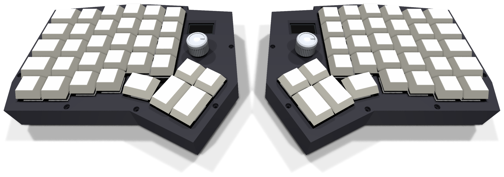
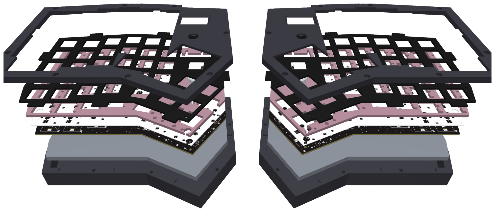
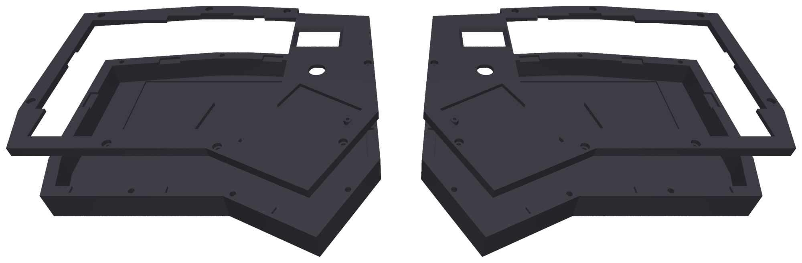
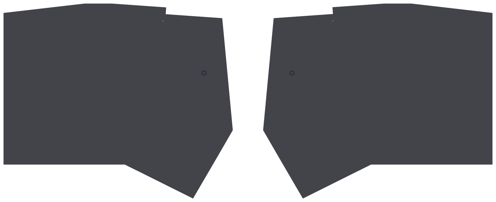
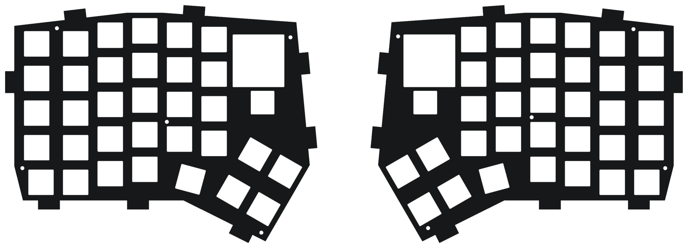

# Keygen

**A wireless split ergonomic keyboard with a custom two-layer PCB designed in KiCad 10.**


Keygen is a one-off build: 66 keys over two column-staggered halves, a 2 × 2 thumb cluster, a rotary
encoder and a 0.96-inch OLED on each half, and per-key RGB lighting. Each half has its own
nRF52840 controller hidden on the PCB underside. The keyboard reaches the host over Bluetooth or
USB-C, and the halves talk to each other over Bluetooth.

The schematic, placement and most of the routing are generated by the Python scripts in
[`tools/`](tools/), so every step from layout to Gerbers can be rerun. The switch plate and the
3D-printed case are generated from the PCB the same way.

The name comes from Martin Garrix's track *Keygen* (STMPD RCRDS), whose cover is a fake
keygen.exe window. The board is black with white silkscreen, and the silkscreen borrows from that
cover; see [The name and the artwork](#the-name-and-the-artwork).

## Contents

- [Specifications](#specifications)
- [Gallery](#gallery)
- [The name and the artwork](#the-name-and-the-artwork)
- [Documentation](#documentation)
- [Hardware](#hardware)
- [Firmware](#firmware)
- [Repository layout](#repository-layout)
- [Building from source](#building-from-source)
- [Ordering and assembly](#ordering-and-assembly)
- [Project status](#project-status)
- [Credits and licenses](#credits-and-licenses)

## Specifications

| | |
|---|---|
| Layout | Column-staggered QWERTY, six columns per hand plus an extra bottom row |
| Keys | 66 (33 per half): 52 × 1u, 10 × 1.25u, 4 × 1.5u |
| Thumb cluster | 2 × 2 block rotated 30° (two 1u over two 1.5u) plus one 1.25u key per hand |
| Encoders | Alps EC11 on each half with a 17 mm knurled aluminium knob, in the key matrix. Left: scroll wheel, press for middle click. Right: volume, press to mute |
| Displays | 0.96 in. 128 × 64 SSD1306 OLED per half (I2C), showing ZMK's status screen |
| Switches | Akko V3 Lavender Purple Pro (tactile, 5-pin) in Kailh hotswap sockets (CPG151101S11) |
| Keycaps | Blank DSA PBT, smoke translucent |
| Lighting | 33 SK6812MINI-E reverse-mount RGB LEDs per half, powered from the battery through a MOSFET switch, on while that half has USB power |
| Controller | nice!nano v2 (nRF52840, Pro Micro format), one per half, socketed on the underside |
| Connectivity | Host: USB-C (left half) or Bluetooth, 5 profiles. Halves: Bluetooth split |
| Power | LiPo pouch per half (≤ 5 mm thick, 2500–3000 mAh), JST-PH connector, slide switch driving a P-MOSFET battery switch. Each half charges from its own USB-C |
| PCB | 2 layers, FR-4 1.6 mm, 1 oz copper, HASL, black soldermask with white silkscreen. One half is 162.7 × 125.9 mm |
| Switch plate | FR-4 1.6 mm, black soldermask, no copper, with eight gasket tabs per half |
| Case | 3D-printed PETG, gasket-mounted: a bottom shell and a top frame per half, 177.8 × 143.1 × 22.2 mm. The top frame covers the plate round the keycaps, the OLED and the knob |
| Foam | PE switch foam (0.5 mm) and Poron plate foam (2.5 mm) between the PCB and the plate, case foam (5 mm) on the case floor |
| Firmware | [ZMK](https://zmk.dev) `main` (Zephyr 4.1): QWERTY base with Nav, Fn and System layers, ZMK Studio |

## Gallery

**In the case.** The plate and PCB float on Poron gaskets between the bottom shell and the top frame.
The top frame's deck, level with its rim, covers the plate everywhere but the keycaps. Each half has
a knob and an OLED above its thumb cluster.



**Case layers.** Bottom shell, case foam, PCB, PE switch foam, Poron plate foam, plate with its
gasket tabs, and top frame (switches and keycaps left out).



**Case parts.** The four printed parts: each bottom shell, with its top frame above it. The shells
have the battery bays, the gasket ledges, the heat-set insert holes, the USB-C and power switch
openings and the reset guide tube; the frames have the matching gasket pockets, counterbored
screw holes, and a deck round the keycaps with an OLED window and a hole for the encoder.



**Case underside.** A flat floor with the reset pinhole, and the open USB-C slot at the top edge.



**Switch plate.** FR-4 with black mask and no copper: 14 mm switch cut-outs, an encoder cut-out and an
OLED window per half, the M2 holes, and the eight gasket tabs round each edge.



**Top.** The bottom edge is cut back to the bottom row and thumb keys to leave room for the wrists.
The keygen window sits beside the left thumb cluster; the moon and STMPD emblem beside the right encoder.


**Underside.** Controllers, power switches, battery connectors and reset buttons all sit on the back.
Each reset button is labelled GENERATE.


**Routing.** Front copper in red, back copper in blue. Ground is a fill on both layers.


## The name and the artwork

Keygen is named after *Keygen* by Martin Garrix, released on his label STMPD RCRDS. The cover
shows a keygen.exe window: a "MARTIN GARRIX" title bar, an outlined KEYGEN logo in a starfield
beside a crescent moon, a serial number, and a GENERATE button between two STMPD emblems. The silkscreen reuses those pieces:

| Where | What |
|---|---|
| Top, left half | The window: title bar, KEYGEN logo in a star cloud, moon, the cover's serial `5233-5131-4927-406`, stacked frames behind |
| Top, right half | A crescent moon and the STMPD emblem beside the right encoder |
| Underside, both halves | GENERATE between two STMPD emblems under each reset button. Double-tapping reset enters the bootloader |
| Underside, left half | Credits |
| Underside, right half | A small keygen.exe window: "press GENERATE twice to flash firmware" |
| Everywhere else, both faces | Stars, on any free board area, with a few denser clouds |

[`tools/silkscreen_art.py`](tools/silkscreen_art.py) draws all of it, keeping it 0.25 mm clear of
pads and holes and 0.5 mm inside the board edge, and writes the board stackup (black mask, white
silkscreen, HASL). The letters use a small stroke font defined in the script. The STMPD emblem is
the label's own vector artwork, included as a fan's nod on a one-off board; it remains the
label's mark.

## Documentation

| Document | What it covers |
|---|---|
| [Build plan](plan/index.html) | Layout drawing, connectivity, parts, pin budget, firmware notes, build steps and checklist. Open it in a browser |
| [Schematic (PDF)](pcb/keygen-schematic.pdf) | Printable schematic: a top sheet with left (refs 1xx) and right (refs 2xx) sub-sheets |
| [KiCad project](pcb/keygen.kicad_pro) | Schematic and PCB, KiCad 10. Both halves are in one board file as two separate outlines |
| [Ordering notes](fab/ORDER.md) | Fab order-form settings and what to check in the DFM report |
| [Plate ordering notes](case/plate/PLATE.md) | Order-form settings for the FR-4 switch plates |
| [Assembly BOM](fab/BOM.md) | Every part's references per half, with quantities and soldering notes |
| [Parts and sources](plan/bom.html) | Shopping list with Indian and import sources (from [`bom/bom.csv`](bom/bom.csv)) |
| [Datasheets](docs/datasheets/README.md) | Every part's datasheet, with the page each design fact comes from |
| [Plate print](case/plate/pdf/keygen-plate-print.pdf) | The switch plate at 1:1 on A4, one half per page, for a fit test on paper |
| [Firmware](firmware/README.md) | ZMK configuration: keymap, hardware support, building and flashing |

### Generated files

Everything below is written by a script in [`tools/`](tools/) from the schematic tables and the PCB,
so it can be regenerated after any change (see [Building from source](#building-from-source)).

| File | What it is | Made by |
|---|---|---|
| [`fab/keygen-left-gerbers.zip`](fab/keygen-left-gerbers.zip), [`fab/keygen-right-gerbers.zip`](fab/keygen-right-gerbers.zip) | PCB Gerbers and drill files, one order per half ([`keygen-gerbers.zip`](fab/keygen-gerbers.zip) has both) | `export_fab.py` |
| [`fab/ORDER.md`](fab/ORDER.md) | Order-form settings for the PCBs | `export_fab.py` |
| [`fab/BOM.md`](fab/BOM.md), `fab/BOM-*.csv` | Assembly BOMs per half | `export_bom.py` |
| [`pcb/plate/keygen-plate.kicad_pcb`](pcb/plate/keygen-plate.kicad_pcb) | The switch plate as a KiCad board, both halves | `gen_plate.py` |
| [`case/`](case/) | Everything outside the PCB, one folder per part and one folder per file type inside it (below) | `gen_case.py`, `gen_plate.py`, `plate_print.py` |
| [`pcb/keygen-schematic.pdf`](pcb/keygen-schematic.pdf) | Printable schematic | `kicad-cli sch export pdf` |
| [`pcb/lib/keygen.3dshapes/`](pcb/lib/keygen.3dshapes/) | 3D models for KiCad's 3D view: knob, OLED module, keycaps, controller | `gen_models.py`, `gen_schematic.py` |
| `docs/render-*.png` | The board, case and plate renders above | `render_board.py`, `render_case.py` |
| [`docs/pcb-routing.png`](docs/pcb-routing.png) | Both copper layers | `render_routing.py` |
| `docs/keymap-*.svg` | One picture per keymap layer | `render_keymap.py` |
| [`firmware/boards/shields/keygen/keygen-layouts.dtsi`](firmware/boards/shields/keygen/keygen-layouts.dtsi) | ZMK matrix transform and physical layout | `gen_zmk_layout.py` |

The [`case/`](case/) folder:

```
case/
├── keygen-case.step                    every part in place, for CAD
├── bottom/  stl/  step/                bottom shells (print the STL)
├── top/     stl/  step/                top frames (print the STL)
├── plate/   gerber/  step/  pdf/       switch plates: Gerbers to order, solids, 1:1 paper print
│   └── PLATE.md                        plate order-form settings
└── foam/    dxf/  svg/                 switch, plate and case foam, 1:1 cut files
```

Every file is named `keygen-{left,right}-<part>` (the foam `keygen-{left,right}-{switch,plate,case}-foam`,
the plate Gerbers `keygen-plate-{left,right}-gerbers.zip`).

## Hardware

### Electronics

- **Matrix:** 5 rows × 7 columns per half, COL2ROW, with a 1N4148 diode per key. Each half's
  encoder push switch sits in its matrix at row 0 / column 6.
- **Controller pins:** both halves use the same pin map, with every edge pin in use. LED data is on
  P0.06 and the LED power switch on P0.08. The OLED's I2C is on P0.17 (SDA) and P0.20 (SCL), both
  full-speed pins. The encoder is on P0.10 and P0.09, the NFC pins, set up as GPIOs in firmware.
  The full pin table is in the [build plan](plan/index.html).
- **OLED:** a generic 0.96 in. SSD1306 module per half, its own header pins soldered into the board
  (pin order GND, VCC, SCL, SDA), standing in a window in the plate. It sits over the controller's
  lower end with its header along its bottom edge, and the firmware turns the image 180°. It runs
  from the nice!nano's switched 3.3 V output (VCC), which the firmware keeps on through P0.13.
- **Power and charging:** each half has its own LiPo and charges through its own controller's
  USB-C; a 1-to-2 USB-C cable charges both from one charger. The nice!nano's BOOST jumper is
  bridged for 500 mA charging.
- **Battery switch:** the MSK12C02 slide switch drives the gate of an AO3401A P-MOSFET, which
  carries the battery current: source on the battery, drain on B+. A 1 MΩ resistor holds the gate
  off between positions. Leave the switch on while charging.
- **Battery:** a pouch up to 60 × 88 × 5 mm lies in a bay sunk 1 mm into the case floor, under the
  outer and middle key columns, its lead end towards the battery connector. It sits 2.5 mm below the
  solder joints on the PCB's underside and at least 15 mm from the controller's antenna end.
- **LED power:** the LEDs run from the battery (B+) through an AO3401A P-MOSFET, whose gate an
  AO3400A N-MOSFET on P0.08 pulls low to turn them on. 100 kΩ resistors hold both MOSFETs off, and
  a 10 µF + 100 nF pair sits at the switch's output.
- **Antenna:** each controller's antenna end is kept clear of the ground fill, and the case is
  plastic.

### Parts per half

| Part | Left | Right |
|---|---|---|
| nRF52840 controller (socketed, underside) | 1 | 1 |
| Akko V3 Lavender Purple Pro switch + Kailh hotswap socket | 33 | 33 |
| 1N4148 diode (DO-35) | 34 | 34 |
| SK6812MINI-E RGB LED | 33 | 33 |
| 10 µF + 100 nF capacitors, 1206 (LED rail) | 1 + 1 | 1 + 1 |
| LiPo battery + JST-PH connector | 1 | 1 |
| MSK12C02 power slide switch | 1 | 1 |
| AO3401A P-MOSFET + 1 MΩ gate resistor, 1206 (battery switch) | 1 + 1 | 1 + 1 |
| AO3401A P-MOSFET, AO3400A N-MOSFET, 2 × 100 kΩ, 1206 (LED power switch) | 1 + 1 + 2 | 1 + 1 + 2 |
| 6 mm reset button | 1 | 1 |
| EC11 encoder + knob | 1 | 1 |
| 0.96 in. SSD1306 OLED module, I2C | 1 | 1 |

### Plate and case

- **Gasket mount:** the plate and PCB are tied together by M2 × 3.5 mm standoffs and touch the
  case only through Poron strips (12 × 4 × 2 mm), one above and one below each of the plate's 8 tabs
  per half. Closing the case squeezes each strip by 0.4 mm.
- **Plate:** 14 × 14 mm cut-outs following each key's rotation, a 13 × 13 mm encoder cut-out and a
  28.5 × 29 mm OLED window per half, and the PCB's M2 holes. Plate screws go in at H102–H105 and H202–H204; the standoffs at H101, H201
  and H205 are screwed from below only.
- **Case:** the bottom shell and top frame are screwed together with 8 M2 × 6 screws per half into
  heat-set inserts, none within 15 mm of the controller's antenna end. The PCB top sits 13.6 mm
  above the desk and the plate top 18.6 mm.
- **Top frame deck:** level with the frame's rim, 3.6 mm above the plate top, covering the plate
  everywhere but the keycaps (0.6 mm clear of each), the OLED window and the encoder. The
  OLED window opens out towards the thumbs; the glass sits 3.5 mm below the deck top. The encoder
  bushing passes through a 9 mm hole under the knob, whose underside is 2.9 mm above the deck.
- **Foam:** three layers per half, cut from the files in [`case/foam/`](case/foam/) (DXF or SVG).
  - PE switch foam, 0.5 mm, on the PCB under the switches, with a hole for every pin, pad, LED
    window and standoff, and for the encoder and the OLED header.
  - Poron plate foam, 2.5 mm, on the PE foam under the plate, with the plate's switch, encoder and
    OLED cut-outs (switches 14.4 mm) and holes for the pads and standoffs.
  - Case foam, 5 mm EVA or Poron, on the case floor round the battery bay, the controller, the
    battery connector, the slide switch, the reset tube and the encoder and OLED pins. It sits
    2.0 mm below the parts under the PCB.
  - The PE and plate foam go onto the PCB before the plate, and the case foam into the bottom shell
    before the plate-and-PCB unit.
- **Openings:** an open 20 mm USB-C slot and a 9 × 3.4 mm power switch slot on the top edge, with
  the wall thinned to 1.5 mm in front of them, and a 2 mm reset pinhole in the floor with a guide
  tube up to the button.
- **Fit check:** [`tools/gen_case.py`](tools/gen_case.py) checks every case part against the PCB,
  the plate, the controller, the reset button, the battery, the OLED, the encoder, the knob, the
  plate screw heads and the keycaps at the bottom of their travel; each foam layer against the
  parts beside it; and a 5.5 mm cell and the case foam against the parts under the PCB with the
  stack pressed 1.5 mm down onto its gaskets. It finds no overlaps.

### PCB

- **Routed and DRC clean.** DRC with schematic parity shows 0 errors, 0 warnings, 0 unconnected
  items and 0 parity issues.
- **Rules:** 0.25 mm signal and 0.4 mm power traces, 0.2 mm clearance, 0.15 mm minimum track,
  0.2 mm copper-to-edge. That is within Lion Circuits' 6/6 mil capability.
- **Routing:** Freerouting does most of the signal routing, then a custom grid maze router
  finishes the rest. All tracks are then straightened into 0/45/90° runs.
- **Datasheet audit:** [`tools/check_datasheets.py`](tools/check_datasheets.py) checks the routed
  board against each part's datasheet: pinouts, orientations, nRF52840 pin restrictions, the battery
  path, antenna clearance and the current budget.

## Firmware

Keygen runs [ZMK](https://zmk.dev). The configuration in [`firmware/`](firmware/) builds for both
halves; it has not yet run on the boards. [`firmware/README.md`](firmware/README.md) has the keymap
and the build and flash steps. In short:

- One build per half on the nice!nano v2 (`nice_nano//zmk`); the halves talk over Bluetooth, the
  left half is the central
- USB-C on the left half plus 5 Bluetooth profiles to the host, and ZMK Studio for live remapping
- QWERTY base layer; Nav (HJKL arrows), Fn (F-keys, numpad, media) and System (Bluetooth, output,
  LEDs, bootloader) layers on the two 1.25u thumb keys
- Left knob: a scroll wheel (with Super held, it walks Hyprland's workspaces), press for a middle
  click. Right knob: volume, press to mute
- Each half's OLED shows ZMK's status screen: output, Bluetooth profile, layer and battery on the
  left, the right half's own battery and link on the right. It blanks when the keyboard is idle
- The per-key LEDs light only while that half has USB power, and their power switch (P0.08) turns off with them



```sh
python3 tools/gen_zmk_layout.py   # firmware/boards/shields/keygen/keygen-layouts.dtsi
firmware/build.sh                 # UF2s in firmware/out/, built in ZMK's Docker image
```

GitHub Actions builds the same UF2s on every push that changes `firmware/`.

## Repository layout

```
keygen/
├── pcb/            KiCad 10 project: schematic (generated), PCB, plate, project footprints and 3D models
├── tools/          Python scripts that generate, route, check and export the design
├── fab/            Gerbers per half and combined (PCB and plate), assembly BOMs, ordering notes
├── case/           Case, plate and foam: one folder per part, one folder per file type (below)
├── bom/            Bill of materials with sources (bom.csv)
├── plan/           Build plan and parts list as HTML
├── docs/           Renders, keymap pictures, plate print and part datasheets
├── firmware/       ZMK configuration: shield, keymap, builds
└── lib/            Git submodules: marbastlib and Keebio-Parts footprint libraries
```

## Building from source

### Requirements

- [KiCad 10](https://www.kicad.org), including its `pcbnew` Python module and `kicad-cli`
- Python 3 with `numpy` and `pycairo`
- Java 17 or newer and [Freerouting 2.5.0](https://github.com/freerouting/freerouting/releases),
  saved as `tools/freerouting-2.5.0.jar` (not checked in)
- For the case: [build123d](https://build123d.readthedocs.io/) and
  [shapely](https://shapely.readthedocs.io/) in a virtual environment that can also see KiCad's
  `pcbnew`:

  ```sh
  uv venv ~/.venvs/keygen-cad --python /usr/bin/python3 --system-site-packages
  uv pip install --python ~/.venvs/keygen-cad/bin/python build123d shapely
  ```

```sh
git clone --recursive https://github.com/milindmadhukar/keygen.git
```

### Schematic

The schematics are generated, so edit the tables in
[`tools/gen_schematic.py`](tools/gen_schematic.py) rather than the KiCad files:

```sh
python3 tools/gen_schematic.py     # write pcb/*.kicad_sch
python3 tools/check_schematic.py   # KiCad ERC plus a netlist check against the tables
```

### PCB pipeline

Run these in order. Each step is a script in `tools/`.

| Step | Script | What it does |
|---|---|---|
| 1 | `gen_pcb.py` | Places every footprint from the schematic, draws the outline, picks mounting holes |
| 2 | `trim_outline.py` | Cuts the bottom edge back to the bottom row and thumb keys (on a routed board, reroute whatever it cuts) |
| 3 | `route_pcb.py` | Routes signals with Freerouting, leaving ground to the fill |
| 4 | `finish_route.py` | Grid maze router for whatever Freerouting leaves (`--include-gnd`, `--pads-to-ground REF.PAD`) |
| 5 | `smooth_route.py` | Straightens tracks into 0/45/90° runs |
| 6 | `stitch_gnd.py`, `cleanup_pcb.py` | Ground stitching vias; removes dangling copper |
| 7 | `sync_pcb.py` | Relinks footprints to the schematic; redraws any `keygen` library footprint whose graphics changed in the library |
| 8 | `silkscreen_art.py` | Moves footprint labels off the edge, pads and other silkscreen, then the black-mask stackup and the silkscreen artwork; rerunnable, replaces its previous output (about 2 minutes) |

Then check the result. `kicad-cli pcb drc --schematic-parity` is the judge; pass it an absolute path.

```sh
kicad-cli pcb drc --schematic-parity --units mm "$PWD/pcb/keygen.kicad_pcb"
python3 tools/check_datasheets.py      # exits 1 on any FAIL; -v lists the passes
```

### Plate and case

Both follow the PCB, through the shared geometry in
[`tools/case_geometry.py`](tools/case_geometry.py), so rerun them after any PCB change.

```sh
python3 tools/gen_plate.py                        # pcb/plate/, case/plate/gerber/, case/plate/PLATE.md
~/.venvs/keygen-cad/bin/python tools/gen_case.py  # case/{bottom,top}/, case/plate/step/, case/foam/, the fit check
python3 tools/render_case.py                      # docs/render-case*.png, docs/render-plate.png
~/.venvs/keygen-cad/bin/python tools/gen_models.py  # pcb/lib/keygen.3dshapes/: the knob and OLED 3D models
```

### Outputs

```sh
python3 tools/export_fab.py      # fab/: Gerbers, drill files, ORDER.md
python3 tools/export_bom.py      # fab/: assembly BOMs from the schematic
python3 tools/render_bom.py      # plan/bom.html from bom/bom.csv
python3 tools/plate_print.py     # case/plate/pdf/keygen-plate-print.pdf
kicad-cli sch export pdf -o pcb/keygen-schematic.pdf pcb/keygen.kicad_sch
python3 tools/render_board.py    # docs/render-*.png: 3D renders with the black mask
python3 tools/render_routing.py  # docs/pcb-routing.png
python3 tools/render_keymap.py   # docs/keymap-*.svg: one picture per keymap layer
```

## Ordering and assembly

Order `fab/keygen-left-gerbers.zip` and `fab/keygen-right-gerbers.zip` as two separate orders of 5.
Per half came out cheaper at Lion Circuits than the combined file. The boards are ordered bare and
everything is hand-soldered. [`fab/ORDER.md`](fab/ORDER.md) has the order-form settings and the
points to raise with the fab: the reverse-mount LED cut-outs must be milled, and the LED pads sit
close to them.

The switch plates are ordered the same way, from the two zips in
[`case/plate/gerber/`](case/plate/gerber/); [`case/plate/PLATE.md`](case/plate/PLATE.md) has the
settings. The four case parts in [`case/bottom/stl/`](case/bottom/stl/) and
[`case/top/stl/`](case/top/stl/) go to a 3D printing service. The foam is cut by laser or by hand
from the 1:1 files in [`case/foam/dxf/`](case/foam/dxf/) or [`case/foam/svg/`](case/foam/svg/). The fasteners, gaskets and
foam sheets are in the [parts list](plan/bom.html).

## Project status

- [x] Layout and schematic, ERC clean
- [x] PCB placed, routed, DRC clean with schematic parity
- [x] Datasheet audit with no failures
- [x] Manufacturing files and assembly BOM
- [ ] Boards ordered and assembled
- [ ] ZMK firmware
- [x] Switch plate and gasket-mounted case designed, fit-checked against the PCB
- [ ] Case printed, with tenting

## Credits and licenses

- Footprints from [marbastlib](https://github.com/ebastler/marbastlib) (CERN-OHL-P v2) and
  [Keebio-Parts](https://github.com/keebio/Keebio-Parts.pretty) (MIT), included as git submodules.
- MX switch 3D model from [kiswitch](https://github.com/kiswitch/kiswitch) (MIT / CC-BY-SA 4.0); see
  [`pcb/lib/keygen.3dshapes/NOTICE.md`](pcb/lib/keygen.3dshapes/NOTICE.md).
- Datasheets in [`docs/datasheets/`](docs/datasheets/) belong to their manufacturers.
