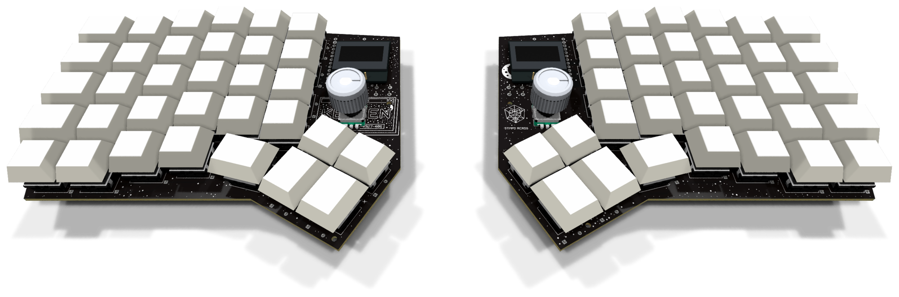
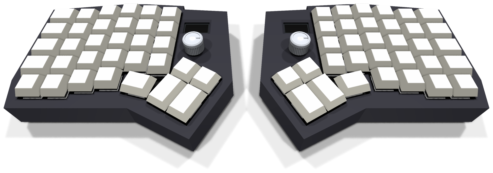
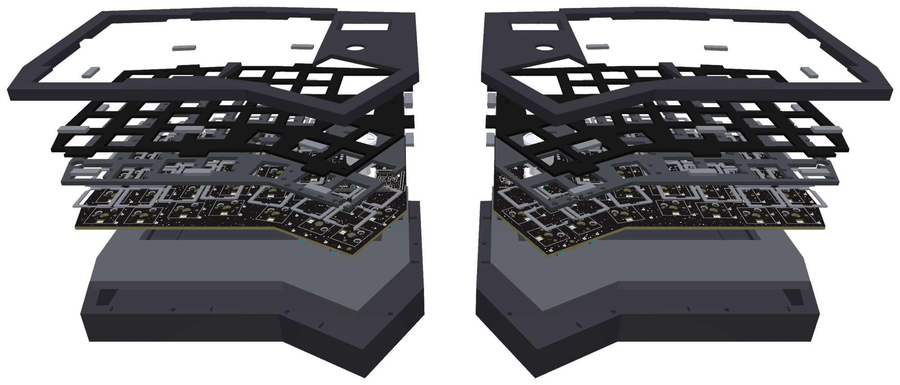
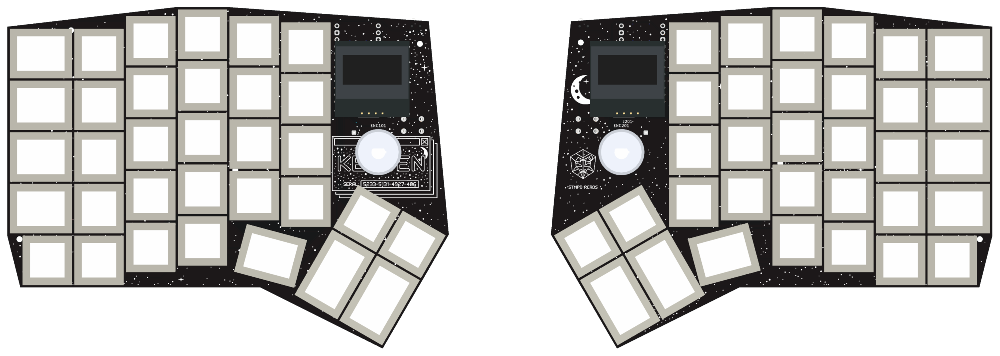
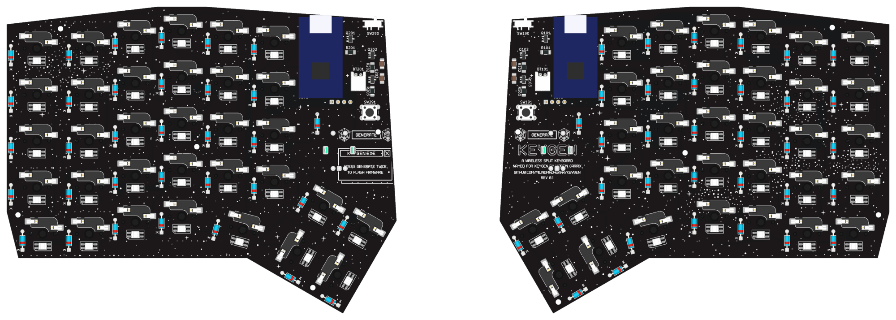

# Keygen

**A wireless split ergonomic keyboard with a custom two-layer PCB designed in KiCad 10.**




Keygen is a one-off build: 66 keys over two column-staggered halves, a 2 × 2 thumb cluster, a rotary
encoder and a 0.96-inch OLED on each half, and per-key RGB lighting. Each half has its own
nRF52840 controller hidden on the PCB underside. The keyboard reaches the host over Bluetooth or
USB-C, and the halves talk to each other over Bluetooth.

The schematic, placement and most of the routing are generated by the Python scripts in
[`tools/`](tools/), and so are the switch plate and the 3D-printed case. The name and the
silkscreen artwork come from Martin Garrix's track *Keygen* (STMPD RCRDS); see
[Silkscreen artwork](notes/16%20-%20hardware%20reference.md#silkscreen-artwork).

**To build one, follow [INSTRUCTIONS.md](INSTRUCTIONS.md).**

## Specifications

| | |
|---|---|
| Layout | Column-staggered QWERTY, six columns per hand plus an extra bottom row |
| Keys | 66 (33 per half): 52 × 1u, 10 × 1.25u, 4 × 1.5u |
| Thumb cluster | 2 × 2 block rotated 30° (two 1u over two 1.5u) plus one 1.25u key per hand |
| Encoders | EC11 with a 20 mm D shaft on each half, with a 17 mm aluminium D-shaft knob, in the key matrix. Left: scroll wheel, press for middle click. Right: volume, press to mute |
| Displays | 0.96 in. 128 × 64 SSD1306 OLED per half (I2C), showing ZMK's status screen |
| Switches | Akko V3 Lavender Purple Pro (tactile, 5-pin) in Kailh hotswap sockets (CPG151101S11) |
| Keycaps | Blank DSA PBT, smoke translucent |
| Lighting | 33 SK6812MINI-E reverse-mount RGB LEDs per half, powered from the battery through a MOSFET switch, on while that half has USB power |
| Controller | nRF52840 SuperMini (nice!nano v2 clone, Pro Micro format), one per half, socketed on the underside |
| Connectivity | Host: USB-C (left half) or Bluetooth, 5 profiles. Halves: Bluetooth split |
| Power | 505080 LiPo pouch per half (5 × 50 × 80 mm, about 2500 mAh) with a protection board, JST-PH connector, slide switch driving a P-MOSFET battery switch. Each half charges from its own USB-C |
| PCB | 2 layers, FR-4 1.6 mm, 1 oz copper, HASL, black soldermask with white silkscreen. One half is 162.7 × 125.9 mm |
| Switch plate | FR-4 1.6 mm, black soldermask, no copper, with eight gasket tabs per half |
| Case | 3D-printed PETG, gasket-mounted: a bottom shell and a top frame per half, 177.8 × 143.1 × 22.2 mm. The top frame covers the plate round the keycaps, the OLED and the knob |
| Foam | Poron ring switch pads (0.5 mm) and EVA plate foam (2 mm) between the PCB and the plate, EVA case foam (5 mm) on the case floor |
| Firmware | [ZMK](https://zmk.dev) `main` (Zephyr 4.1): QWERTY base with Nav, Fn and System layers, ZMK Studio |

## Gallery

**In the case.** The plate and PCB float on Poron gaskets between the bottom shell and the top frame.



**Case layers.** Bottom shell, case foam, PCB, switch pads, plate foam, plate and top frame.



**PCB, top and underside.** The controllers, power switches, battery connectors and reset buttons
sit on the back.





Renders of the case parts, the plate and the routing are in [`assets/`](assets/).

## Documentation

| Document | What it covers |
|---|---|
| [Assembly instructions](INSTRUCTIONS.md) | Step by step: ordering, soldering, flashing, closing the case, troubleshooting |
| [Hardware reference](notes/16%20-%20hardware%20reference.md) | Electronics, PCB rules, plate, case, foam and the silkscreen artwork |
| [Building from source](notes/17%20-%20building%20from%20source.md) | Requirements, the schematic and PCB pipeline, the plate and case, every generated file |
| [Firmware](firmware/README.md) | ZMK configuration: keymap, hardware support, building and flashing |
| [Design notes](notes/index.md) | The Obsidian design notes: layout, controller, PCB, case, final design, datasheet audit |
| [Build plan](plan/index.html) | Layout drawing, connectivity, parts, pin budget and checklist. Open it in a browser |
| [Schematic (PDF)](pcb/keygen-schematic.pdf) | A top sheet with left (refs 1xx) and right (refs 2xx) sub-sheets |
| [KiCad project](pcb/keygen.kicad_pro) | Schematic and PCB, KiCad 10. Both halves are in one board file as two separate outlines |
| [Ordering notes](fab/ORDER.md) | PCB order-form settings and what to check in the DFM report |
| [Plate ordering notes](case/plate/PLATE.md) | Order-form settings for the FR-4 switch plates, and the DXFs for cutting them from sheet |
| [Assembly BOM](fab/BOM.md) | Every part's references per half, with quantities and soldering notes |
| [Parts and sources](plan/bom.html) | Shopping list with Indian and import sources (from [`bom/bom.csv`](bom/bom.csv)) |
| [Shopping checklist](bom/CHECKLIST.md) | What to buy, from which store, with links and prices, to tick off |
| [Datasheets](docs/datasheets/README.md) | Every part's datasheet, with the page each design fact comes from |

## Firmware

Keygen runs [ZMK](https://zmk.dev), one build per half on the nice!nano v2 target, with the left half as
the central. The configuration builds; it has not yet run on the boards. GitHub Actions builds the
UF2s on every push that changes `firmware/`. The keymap, the build and the flashing steps are in
[`firmware/README.md`](firmware/README.md).


## Repository layout

```
keygen/
├── INSTRUCTIONS.md Step-by-step assembly
├── pcb/            KiCad 10 project: schematic (generated), PCB, plate, project footprints and 3D models
├── tools/          Python scripts that generate, route, check and export the design
├── fab/            Gerbers per half and combined, assembly BOMs, ordering notes
├── case/           Case, plate and foam: one folder per part, one folder per file type
├── bom/            Bill of materials with sources (bom.csv) and the shopping checklist
├── plan/           Build plan and parts list as HTML
├── docs/           Part datasheets
├── assets/         Renders and keymap pictures
├── notes/          Design notes, hardware reference and build pipeline (Obsidian Markdown)
├── firmware/       ZMK configuration: shield, keymap, builds
└── lib/            Git submodules: marbastlib and Keebio-Parts footprint libraries
```

## Project status

- [x] Layout and schematic, ERC clean
- [x] PCB placed, routed, DRC clean with schematic parity
- [x] Datasheet audit with no failures
- [x] Manufacturing files and assembly BOM
- [ ] Boards ordered and assembled
- [ ] ZMK firmware
- [x] Switch plate and gasket-mounted case designed, fit-checked against the PCB
- [ ] Case printed, with tenting

## Credits and licenses

- Footprints from [marbastlib](https://github.com/ebastler/marbastlib) (CERN-OHL-P v2) and
  [Keebio-Parts](https://github.com/keebio/Keebio-Parts.pretty) (MIT), included as git submodules.
- MX switch 3D model from [kiswitch](https://github.com/kiswitch/kiswitch) (MIT / CC-BY-SA 4.0); see
  [`pcb/lib/keygen.3dshapes/NOTICE.md`](pcb/lib/keygen.3dshapes/NOTICE.md).
- Datasheets in [`docs/datasheets/`](docs/datasheets/) belong to their manufacturers.
