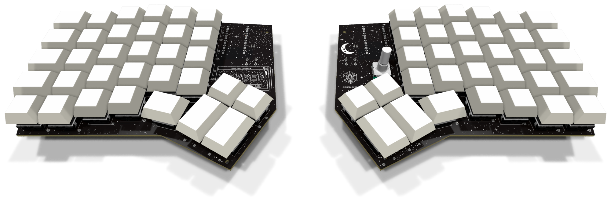
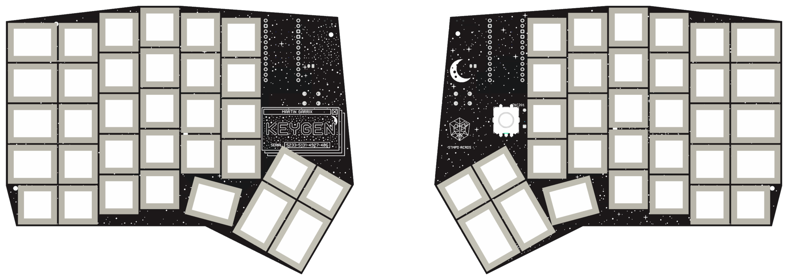
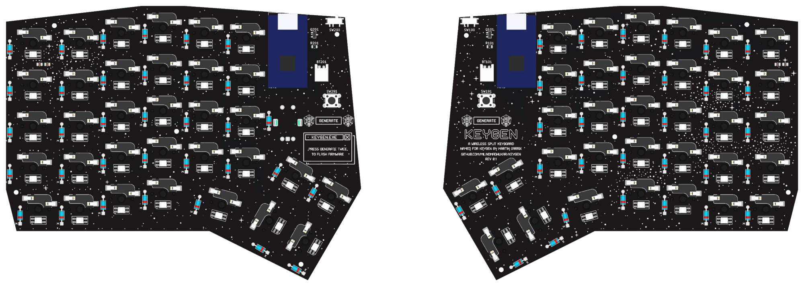
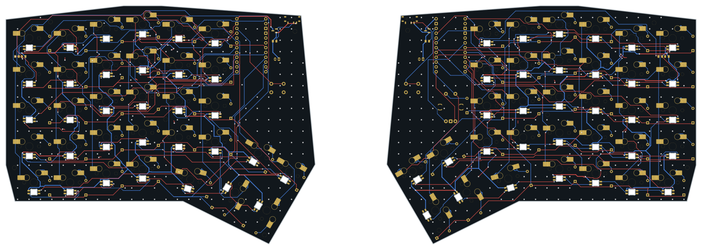

# Keygen

**A wireless split ergonomic keyboard with a custom two-layer PCB designed in KiCad 10.**




Keygen is a one-off build: 66 keys over two column-staggered halves, a 2 × 2 thumb cluster, a rotary encoder
on the right half, and per-key RGB that doubles as the status display. Each half has its own
nRF52840 controller hidden on the PCB underside. The keyboard reaches the host over Bluetooth or
USB-C, and the halves talk to each other over Bluetooth.

The schematic, placement and most of the routing are generated by the Python scripts in
[`tools/`](tools/), so every step from layout to Gerbers can be rerun.

The name comes from Martin Garrix's track *Keygen* (STMPD RCRDS), whose cover is a fake
keygen.exe window. The board is black with white silkscreen, and the silkscreen borrows from that
cover; see [The name and the artwork](#the-name-and-the-artwork).

## Contents

- [Specifications](#specifications)
- [Gallery](#gallery)
- [The name and the artwork](#the-name-and-the-artwork)
- [Documentation](#documentation)
- [Hardware](#hardware)
- [Firmware](#firmware)
- [Repository layout](#repository-layout)
- [Building the PCB from source](#building-the-pcb-from-source)
- [Ordering and assembly](#ordering-and-assembly)
- [Project status](#project-status)
- [Credits and licenses](#credits-and-licenses)

## Specifications

| | |
|---|---|
| Layout | Column-staggered QWERTY, six columns per hand plus an extra bottom row |
| Keys | 66 (33 per half): 52 × 1u, 10 × 1.25u, 4 × 1.5u. No stabilizers |
| Thumb cluster | 2 × 2 block rotated 30° (two 1u over two 1.5u) plus one 1.25u key per hand |
| Encoder | Alps EC11 on the right half, in the key matrix (push to mute, turn for volume) |
| Switches | MX-style in Kailh hotswap sockets (CPG151101S11) |
| Lighting | 33 SK6812MINI-E reverse-mount RGB LEDs per half, used as the status display. No underglow |
| Controller | nice!nano v2 (nRF52840, Pro Micro format), one per half, socketed on the underside |
| Connectivity | Host: USB-C (left half) or Bluetooth, 5 profiles. Halves: Bluetooth split |
| Power | LiPo pouch per half (≤ 5 mm thick, 1000–1500 mAh), JST-PH connector, slide switch driving a P-MOSFET battery switch. Each half charges from its own USB-C |
| PCB | 2 layers, FR-4 1.6 mm, 1 oz copper, HASL, black soldermask with white silkscreen. One half is 162.7 × 125.9 mm |
| Firmware | [ZMK](https://zmk.dev) with [zmk-rgb-matrix](https://github.com/dima-m711/zmk-rgb-matrix) for per-key indicators |

## Gallery

**Top.** The bottom edge is cut back to the bottom row and thumb keys to leave room for the wrists.
The keygen window sits beside the left thumb cluster; the moon and STMPD emblem beside the encoder.



**Underside.** Controllers, power switches, battery connectors and reset buttons all sit on the back.
Each reset button is labelled GENERATE.



**Routing.** Front copper in red, back copper in blue. Ground is a fill on both layers.



## The name and the artwork

Keygen is named after *Keygen* by Martin Garrix, released on his label STMPD RCRDS. The cover
shows a keygen.exe window: a "MARTIN GARRIX" title bar, an outlined KEYGEN logo in a starfield
beside a crescent moon, a serial number, and a GENERATE button between two STMPD emblems. The silkscreen reuses those pieces:

| Where | What |
|---|---|
| Top, left half | The window: title bar, KEYGEN logo in a star cloud, moon, the cover's serial `5233-5131-4927-406`, stacked frames behind |
| Top, right half | A crescent moon and the STMPD emblem beside the encoder |
| Underside, both halves | GENERATE between two STMPD emblems under each reset button. Double-tapping reset enters the bootloader |
| Underside, left half | Credits |
| Underside, right half | A small keygen.exe window: "press GENERATE twice to flash firmware" |
| Everywhere else, both faces | Stars, on any free board area, with a few denser clouds |

[`tools/silkscreen_art.py`](tools/silkscreen_art.py) draws all of it, keeping it 0.25 mm clear of
pads and holes and 0.5 mm inside the board edge, and writes the board stackup (black mask, white
silkscreen, HASL). The letters use a small stroke font defined in the script. The STMPD emblem is
the label's own vector artwork, included as a fan's nod on a one-off board; it remains the
label's mark.

## Documentation

| Document | What it covers |
|---|---|
| [Build plan](plan/index.html) | Layout drawing, connectivity, parts, pin budget, firmware notes, build steps and checklist. Open it in a browser |
| [Schematic (PDF)](pcb/keygen-schematic.pdf) | Printable schematic: a top sheet with left (refs 1xx) and right (refs 2xx) sub-sheets |
| [KiCad project](pcb/keygen.kicad_pro) | Schematic and PCB, KiCad 10. Both halves are in one board file as two separate outlines |
| [Ordering notes](fab/ORDER.md) | Fab order-form settings and what to check in the DFM report |
| [Assembly BOM](fab/BOM.md) | Every part's references per half, with quantities and soldering notes |
| [Parts and sources](plan/bom.html) | Shopping list with Indian and import sources (from [`bom/bom.csv`](bom/bom.csv)) |
| [Datasheets](docs/datasheets/README.md) | Every part's datasheet, with the page each design fact comes from |
| [Plate print](docs/plate-print.pdf) | The switch plate at 1:1 on A4, one half per page, for a fit test on paper |
| [Firmware](firmware/README.md) | ZMK configuration plan and requirements |

## Hardware

### Electronics

- **Matrix:** 5 rows × 7 columns per half, COL2ROW, with a 1N4148 diode per key. The right
  half's encoder push switch sits in the matrix at row 0 / column 6.
- **Controller pins:** both halves use the same pin map apart from the encoder. LED data is on a
  full-speed pin. The encoder's B line uses an NFC pin, set up as a GPIO in
  firmware. The full pin table is in the [build plan](plan/index.html).
- **Power and charging:** each half has its own LiPo and charges through its own controller's
  USB-C; a 1-to-2 USB-C cable charges both from one charger. The nice!nano's BOOST jumper is
  bridged for 500 mA charging. The halves share no cable, so their batteries are never tied together.
- **Battery switch:** the MSK12C02 slide switch is rated 50 mA, so it only drives the gate of an
  AO3401A P-MOSFET that carries the battery current. The MOSFET's source is on the battery and its drain on
  B+, so its body diode blocks the battery when the switch is off. A 1 MΩ resistor holds the gate
  off between positions. Leave the switch on while charging.
- **Battery:** a pouch up to 5 mm thick lies flat over the hotswap sockets under the inner key
  columns, on a kapton sheet, at least 15 mm from the controller's antenna end. The socketed
  controller already needs about 7.5 mm below the PCB, so the battery adds no case height.
- **No TRRS:** a wired link between the halves would need its own ZMK build, could not charge the
  other half, and must never be hot-plugged while a half is powered. It was removed; the two
  full-speed pins it used (P0.08, P0.17) are spare.
- **LED power:** the LED rail runs from the controller's switched VCC (P0.13), so firmware can cut
  it completely when the LEDs are off.
- **Antenna:** each controller's antenna end is kept clear of the ground fill, and the case is
  plastic.

### Parts per half

| Part | Left | Right |
|---|---|---|
| nRF52840 controller (socketed, underside) | 1 | 1 |
| MX switch + Kailh hotswap socket | 33 | 33 |
| 1N4148 diode (DO-35) | 33 | 34 |
| SK6812MINI-E RGB LED | 33 | 33 |
| 10 µF + 100 nF capacitors (LED rail) | 1 + 1 | 1 + 1 |
| LiPo battery + JST-PH connector | 1 | 1 |
| MSK12C02 power slide switch | 1 | 1 |
| AO3401A P-MOSFET + 1 MΩ gate resistor (battery switch) | 1 + 1 | 1 + 1 |
| 6 mm reset button | 1 | 1 |
| EC11 encoder + knob | – | 1 |

### PCB

- **Routed and DRC clean.** DRC with schematic parity shows 0 errors, 0 unconnected items and 0
  parity issues. Only cosmetic silkscreen warnings remain.
- **Rules:** 0.25 mm signal and 0.4 mm power traces, 0.2 mm clearance, 0.15 mm minimum track,
  0.2 mm copper-to-edge. That is within Lion Circuits' 6/6 mil capability.
- **Routing:** Freerouting does most of the signal routing, then a custom grid maze router
  finishes the rest. All tracks are then straightened into 0/45/90° runs.
- **Datasheet audit:** [`tools/check_datasheets.py`](tools/check_datasheets.py) checks the routed
  board against each part's datasheet: pinouts, orientations, nRF52840 pin restrictions, the battery
  path, antenna clearance and the current budget.

## Firmware

Keygen will run [ZMK](https://zmk.dev). QMK was ruled out because it has no usable Bluetooth split.
The firmware is not written yet. [`firmware/README.md`](firmware/README.md) has the planned ZMK
config layout and what it has to do. In short:

- Bluetooth split, one build per half; plugging USB-C into the left half switches the host link to USB
- USB-C plus 5 Bluetooth profiles, and ZMK Studio for live remapping
- Per-key RGB status: caps lock, active layer, Bluetooth profile, and battery level while Fn is held
- Encoder on the right half: volume, press to mute

## Repository layout

```
keygen/
├── pcb/            KiCad 10 project: schematic (generated), PCB, project footprints and 3D models
├── tools/          Python scripts that generate, route, check and export the design
├── fab/            Gerbers per half and combined, assembly BOMs, ordering notes
├── bom/            Bill of materials with sources (bom.csv)
├── plan/           Build plan and parts list as HTML
├── docs/           Renders, plate print and part datasheets
├── firmware/       ZMK configuration (planned)
└── lib/            Git submodules: marbastlib and Keebio-Parts footprint libraries
```

## Building the PCB from source

### Requirements

- [KiCad 10](https://www.kicad.org), including its `pcbnew` Python module and `kicad-cli`
- Python 3 with `numpy` and `pycairo`
- Java 17 or newer and [Freerouting 2.5.0](https://github.com/freerouting/freerouting/releases),
  saved as `tools/freerouting-2.5.0.jar` (not checked in)

```sh
git clone --recursive https://github.com/milindmadhukar/keygen.git
```

### Schematic

The schematics are generated, so edit the tables in
[`tools/gen_schematic.py`](tools/gen_schematic.py) rather than the KiCad files:

```sh
python3 tools/gen_schematic.py     # write pcb/*.kicad_sch
python3 tools/check_schematic.py   # KiCad ERC plus a netlist check against the tables
```

### PCB pipeline

Run these in order. Each step is a script in `tools/`.

| Step | Script | What it does |
|---|---|---|
| 1 | `gen_pcb.py` | Places every footprint from the schematic, draws the outline, picks mounting holes |
| 2 | `trim_outline.py` | Cuts the bottom edge back to the bottom row and thumb keys (on a routed board, reroute whatever it cuts) |
| 3 | `route_pcb.py` | Routes signals with Freerouting, leaving ground to the fill |
| 4 | `finish_route.py` | Grid maze router for whatever Freerouting leaves (`--include-gnd`, `--pads-to-ground REF.PAD`) |
| 5 | `smooth_route.py` | Straightens tracks into 0/45/90° runs |
| 6 | `stitch_gnd.py`, `cleanup_pcb.py` | Ground stitching vias; removes dangling copper |
| 7 | `sync_pcb.py` | Relinks footprints to the schematic |
| 8 | `silkscreen_art.py` | Black-mask stackup and the silkscreen artwork; rerunnable, replaces its previous output (about 2 minutes) |

Then check the result. `kicad-cli pcb drc --schematic-parity` is the judge; pass it an absolute path.

```sh
kicad-cli pcb drc --schematic-parity --units mm "$PWD/pcb/keygen.kicad_pcb"
python3 tools/check_datasheets.py      # exits 1 on any FAIL; -v lists the passes
```

### Outputs

```sh
python3 tools/export_fab.py      # fab/: Gerbers, drill files, ORDER.md
python3 tools/export_bom.py      # fab/: assembly BOMs from the schematic
python3 tools/render_bom.py      # plan/bom.html from bom/bom.csv
python3 tools/plate_print.py     # docs/plate-print.pdf
python3 tools/render_board.py    # docs/render-*.png: 3D renders with the black mask
python3 tools/render_routing.py  # docs/pcb-routing.png
```

## Ordering and assembly

Order `fab/keygen-left-gerbers.zip` and `fab/keygen-right-gerbers.zip` as two separate orders of 5.
Per half came out cheaper at Lion Circuits than the combined file. The boards are ordered bare and
everything is hand-soldered. [`fab/ORDER.md`](fab/ORDER.md) has the order-form settings and the
points to raise with the fab: the reverse-mount LED cut-outs must be milled, and the LED pads sit
close to them.

## Project status

- [x] Layout and schematic, ERC clean
- [x] PCB placed, routed, DRC clean with schematic parity
- [x] Datasheet audit with no failures
- [x] Manufacturing files and assembly BOM
- [ ] Boards ordered and assembled
- [ ] ZMK firmware
- [ ] 3D-printed case with tenting

## Credits and licenses

- Footprints from [marbastlib](https://github.com/ebastler/marbastlib) (CERN-OHL-P v2) and
  [Keebio-Parts](https://github.com/keebio/Keebio-Parts.pretty) (MIT), included as git submodules.
- MX switch 3D model from [kiswitch](https://github.com/kiswitch/kiswitch) (MIT / CC-BY-SA 4.0); see
  [`pcb/lib/keygen.3dshapes/NOTICE.md`](pcb/lib/keygen.3dshapes/NOTICE.md).
- Datasheets in [`docs/datasheets/`](docs/datasheets/) belong to their manufacturers.
