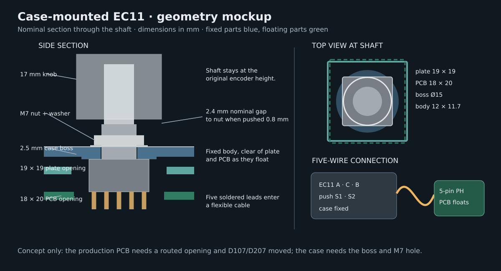

# Case-mounted encoder mockup

This is a **design study**, not a change to the production case, plate, schematic, or PCB. The
inspectable STEP coupon is generated by `tools/mock_encoder_mount.py` at
`case/mockup/encoder-mount-assembled.step`. The script also writes
`case/mockup/encoder-panel-test.stl`, a 30 × 30 mm printable panel coupon for checking the
M7 nut and delivered encoder. Its `z = 0` plane is the top of the current PCB. The
coupon represents the area around one encoder shaft; both halves use the mirrored arrangement.

## Mechanical arrangement

The [selected HongYan EC11H drawing](https://robu.in/wp-content/uploads/2025/08/DATASHEET-EC11H-7CE20P1ZD20F10-%E8%A7%84%E6%A0%BC%E4%B9%A6.pdf)
specifies an M7 × 0.75 bushing, a 10 mm across-flats by 2 mm nut, and an Ø11.5 × 0.3 mm washer.
The encoder is inserted **from below** into a 7.3 mm hole in the top frame. A Ø15 mm boss extends
from the deck down to `z = 6.5`; the supplied washer and nut clamp the encoder against it from above.
The boss joins the existing 2 mm deck, making a 2.5 mm thick local panel. The existing deck shape
fully supports the boss's Ø15 mm footprint on both halves. The nut and washer hide under the 17 mm
knob. Use the washer, and tighten only enough to stop rotation; printed PETG can creep or crack under
excessive nut torque.

| Feature | Mockup value | Why |
|---|---:|---|
| Encoder body | `z = 0…6.5` | Keeps the existing shaft height |
| Case boss and deck | `z = 6.5…9.0`, Ø15 boss | Takes the push load into the fixed frame |
| Panel hole | Ø7.3 | Clears the 7 mm M7 bushing |
| Washer and nut | `z = 9.0…11.3` | Supplied encoder hardware |
| Knob underside | `z = 14.5` | Puts its assumed recessed hub on the shaft's D flat |
| Knob underside, fully pushed | `z = 13.7` | Allows 0.8 mm push travel |
| Pushed knob to nut | 2.4 mm nominal | Measure the delivered knob and encoder before cutting shafts |
| New shaft cut, with an 11 mm blind bore | 1.0 mm nominal | Keeps 9 mm of the shaft's D flat engaged |
| Plate opening | 19 × 19 | Clears the body and boss as the plate floats |
| Main PCB opening | 18 × 20 | Clears the fixed body, pins, and tabs as the PCB floats |

The encoder's [push-switch table specifies 0.5 ± 0.3 mm travel](https://robu.in/wp-content/uploads/2025/08/DATASHEET-EC11H-7CE20P1ZD20F10-%E8%A7%84%E6%A0%BC%E4%B9%A6.pdf),
though its dimension drawing gives +0.2/−0.3 mm. This study uses the larger 0.8 mm limit; the
production case model currently uses 0.7 mm. The 20 mm shaft starts at `z = 26.5`, and its 10 mm
D flat begins at `z = 16.5`. With the assumed 2 mm recessed knob hub, the underside must be at
least `z = 14.5` for the D bore to meet the flat. An 11 mm blind depth then gives a nominal cut of
`26.5 − (14.5 + 11) = 1.0 mm`. The current production plan calls for a 2.4 mm cut and a lower knob;
that geometry may put the unflattened round shaft against the knob's D bore. Check the actual knob's
hub and bore before cutting either shaft. The mockup leaves 5.5 mm between knob skirt and deck;
the nut is hidden from above, but some metal may show from the side. A separate, nonstructural trim
collar could cover it after tightening the nut if the physical mockup needs one. The current model
already allows 1.5 mm downward, 1 mm upward, and
0.5 mm sideways motion of the floating assembly. The fixed encoder must stay clear through all of
that motion. The proposed plate and PCB openings are initial dimensions for this clearance, not
approved fab cutouts.

Assembly order: solder and insulate the five encoder leads, add strain relief to the top frame, fit
the encoder from below, then install the washer and nut from above. Fit the knob after checking its
actual blind-hole depth and the pushed clearance. Connect the cable while lowering the top frame,
then close the case. The cable needs a loose loop; it must not tether the floating PCB to the frame.

## Five-wire connector

Use one **5-position JST PH, 2.0 mm** connection per half. The proposed PCB header is
[`S5B-PH-K-S`](https://www.jst.com/wp-content/uploads/2021/09/ePH.pdf), a side-entry through-hole
part mounted on the **back** of the PCB. It mates with a `PHR-5` housing and five precrimped
contacts or a ready-made 5-pin PH pigtail. The side-entry header projects about 6 mm below the PCB;
the case has 10.9 mm below the PCB nominally, so the case foam needs a matching opening. The exact
PCB position, plug insertion path, cable bend, and battery clearance must be checked in the full
board layout.

| Connector pin | Encoder terminal | Existing PCB net |
|---:|---|---|
| 1 | A | `ENC_A` |
| 2 | C | `GND` |
| 3 | B | `ENC_B` |
| 4 | S1 | `COL6` |
| 5 | S2 | `K06` (diode input) |

The push switch still uses D107/D207 on the PCB; connecting S2 directly to `ROW0` would bypass its
diode. Pin numbers above are a **proposed** assignment. Confirm pin 1 on the chosen footprint and
plug, then verify A/C/B and S1/S2 with a continuity meter before soldering. The 2-pin battery JST
parts in the existing order cannot serve as a 5-pin plug. The existing right-angle 2.54 mm header
strips also do not mate with PH, so this needs **two 5-pin headers and two matching pigtails** in
addition to that order. A locally available [5-pin PH prewired lead](https://www.indianhobbycenter.com/products/5-pin-2mm-pitch-jst-ph-female-connector-with-25cm-wire-2mm-pitch-1-pc)
avoids buying a crimp tool; trim its wire length after the physical fit test.

An India-local pair is Sunrom's [5-pin PH side-entry PCB header](https://www.sunrom.com/p/5-pin-jst-ph-20mm-through-hole-header-horizontal-right-angle-side-entry)
and [5-pin PH prewired lead](https://www.sunrom.com/p/5-pin-jst-ph-20mm-one-side-female-30cm).
Buy two of each, plus spares if desired. The lead comes long and can be shortened after assembly.
Robu lists a [5-pin, 2 mm PH-compatible right-angle header](https://robu.in/product/ph-aw-2mm-5-pin-wafer-male-connector-through-hole-right-angle/),
but its page does not establish a matching prewired lead. BatteriesShop lists an
[XH 5-pin wired pair](https://www.batteriesshop.in/products/5-pin-jst-xh-relimate-connector-rmc-male-female-pair-with-wirecable);
its 2.54 mm pitch is incompatible with the 2.0 mm PH header and needs a different PCB footprint.
The documented AliExpress cart contains no 5-pin encoder connection; it has 2-pin battery plugs
and 4-pin OLED hardware only. The actual placed order has not been inspected.

## PCB work before this can be built

The 18 × 20 opening crosses the existing encoder footprint and routed traces. D107/D207 has a pad
on its proposed edge and must move. Replace each encoder footprint with the PH header, reroute the
five nets and the affected traces, and adjust the plate and foam cutouts. The nearby M2 plate hole
is outside the proposed opening, but the full routing and mechanical fit checks must be rerun.

The case boss, PCB opening, and harness have only been checked as a nominal CAD concept. Validate
with the delivered encoder, nut, washer, knob and a printed mount coupon before applying the
geometry to the production files.
