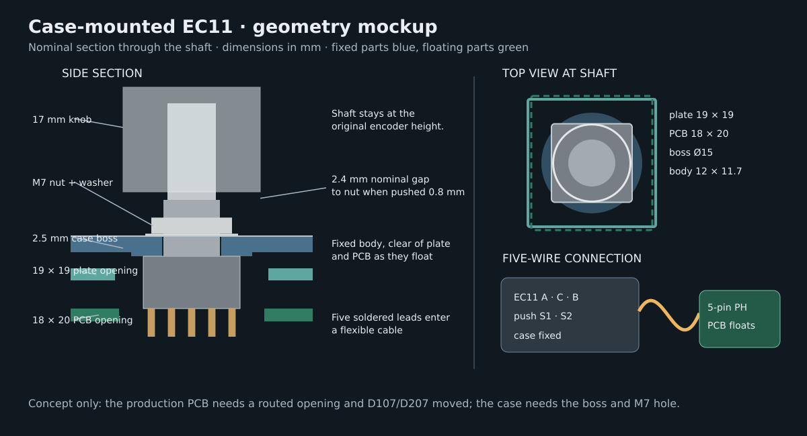

# Encoder mount

Each EC11 is fixed to the top frame. The plate and PCB have openings round it and float clear of it,
so a press on the knob goes into the case. The encoder connects to the PCB by a five-wire lead. The
production parts come from `tools/gen_case.py` and `tools/gen_plate.py`, and `tools/check_mechanical.py`
checks the clearances below through the gasket travel of 1.5 mm down, 1 mm up and 0.5 mm sideways.

## Mount

The [HongYan EC11H](https://robu.in/wp-content/uploads/2025/08/DATASHEET-EC11H-7CE20P1ZD20F10-%E8%A7%84%E6%A0%BC%E4%B9%A6.pdf)
has an M7 × 0.75 bushing, a nut 10 mm across flats and 2 mm thick, and an Ø11.5 × 0.3 mm washer. Its
bushing goes through a hole in the frame from below, and the washer and nut clamp it from above,
under the knob. Heights are from the top of the PCB.

| Feature | Value |
|---|---:|
| Encoder body | `z = 0…6.5`, 12 × 11.7 mm |
| Boss and deck | `z = 6.5…9.0`, Ø15 boss, Ø7.3 hole |
| Cheeks either side of the body, stopping it turning | 1.2 × 9 mm, down to `z = 4.5` |
| Washer and nut | `z = 9.0…11.3` |
| Knob underside | `z = 14.5`, 5.5 mm above the deck |
| Knob underside, fully pushed | `z = 13.7`, 2.4 mm above the nut |
| Shaft cut, with an 11 mm blind bore | 1.0 mm, leaving 9 mm of D flat in the knob |
| Plate opening | 18 × 18 mm |
| PCB opening | 18 × 20 mm |

The shaft's D flat starts at `z = 16.5`, and the knob's hub is 2 mm up inside it, which sets the knob
at `z = 14.5`. Measure the delivered knob: `KNOB_DEPTH` and `KNOB_HUB_UP` in
[`tools/case_geometry.py`](../tools/case_geometry.py) set the knob height and the shaft cut.

## Test coupon

`case/mockup/encoder-panel-test.stl` is a 30 × 30 mm print of the boss and cheeks, from
`tools/regen.py --force encoder-mockup`, with an assembled view in
`case/mockup/encoder-mount-assembled.step`. Fit the delivered encoder, washer, nut and knob on it
before cutting a shaft or printing the case.

## Lead

The PCB carries a 1×5 right-angle 2.54 mm male pin header (J102, J202) on the back, beside the
opening, its pins lying flat and pointing away from the thumb keys. The encoder's lead is five
female–female jumper wires, their plug ends glued side by side into one 5-pin plug, as for the OLED,
and their other ends cut 100 mm away and soldered to the encoder: long enough to plug in with the
frame laid beside the half. The plug lies flat under the PCB, and the spare length folds into the
bay in the case foam under the opening.

| Pin | Encoder terminal | Net |
|---:|---|---|
| 1 (square pad, outer end) | A | `ENC_A` |
| 2 | C | `GND` |
| 3 | B | `ENC_B` |
| 4 | S1 | `COL6` |
| 5 | S2 | `K06`, to the diode D107 / D207 on the PCB |
