# Keygen firmware

Keygen runs [ZMK](https://zmk.dev) `main` (Zephyr 4.1), pinned to one commit in
[`west.yml`](west.yml). Each half is a nice!nano v2 (`nice_nano//zmk`) with its own build; the halves
talk over Bluetooth, with the left half as the central. The config builds; it has not yet run on
the boards.

## Layout

```
firmware/
├── build.yaml                      builds: keygen_left (with ZMK Studio), keygen_right, settings_reset
├── west.yml                        ZMK version
├── keygen.conf                     sleep, battery reporting, LEDs
├── keygen.keymap                   the four layers below and the encoder bindings
├── build.sh                        local build in ZMK's Docker image
└── boards/shields/keygen/
    ├── keygen.dtsi                 5 × 7 matrix (COL2ROW), encoder, physical layout
    ├── keygen-layouts.dtsi         matrix transform and physical layout, from tools/gen_zmk_layout.py
    ├── keygen_left.overlay
    ├── keygen_right.overlay        column offset, encoder, NFC pins as GPIO
    ├── keygen_right.conf           encoder driver
    ├── boards/nice_nano_nrf52840_zmk.overlay   33-LED SK6812 chain on P0.06
    └── Kconfig.*, keygen.zmk.yml
```

[`keygen-layouts.dtsi`](boards/shields/keygen/keygen-layouts.dtsi) is generated from the same Redox
layout and key table as the PCB. Regenerate it after changing either:

```sh
python3 tools/gen_zmk_layout.py
```

## Keymap

The keycaps are blank. Key positions follow [`keygen.keymap`](keygen.keymap); the pictures are
drawn from it and from the physical layout, so the thumb keys and the knob sit where they are on
the board. A held layer key is shown in red; blank keys fall through to the layer below.

```sh
python3 tools/render_keymap.py   # docs/keymap-*.svg, with keymap-drawer through uvx
```

### Base


- `Esc`: tap for Esc, hold for Ctrl.
- `Caps Word`: capitals until the end of the word.
- The two 1.25u thumb keys hold the NAV and FN layers. Holding both gives SYS.
- Encoder (the key marked ↻): volume; press to mute.

### NAV (hold the left 1.25u)



| Keys | Do |
|---|---|
| `H` `J` `K` `L` | ← ↓ ↑ → |
| `Y` `U` `I` `O` | Home, Page Down, Page Up, End |
| `A` `S` `D` `F` | Super, Alt, Ctrl, Shift |
| Encoder | Page Down / Page Up |

### FN (hold the right 1.25u)



| Keys | Do |
|---|---|
| `1` … `0`, `=`, `-` | F1 … F10, F11, F12 |
| `U` `I` `O` / `J` `K` `L` / `M` `,` `.` | Numpad 7 8 9 / 4 5 6 / 1 2 3 |
| `[` `]` | 0 and `.` |
| `Bksp` | Delete |
| `Caps Word` | Caps Lock |
| `Q` `W` | Print Screen, Insert |
| `S` `D` `F` | Previous, play/pause, next track |
| Encoder, encoder press | Screen brightness, play/pause |

### SYS (hold both 1.25u keys)



| Keys | Do |
|---|---|
| `1` … `5` | Bluetooth profile 1 … 5 |
| `=` | Forget the current Bluetooth profile's pairing |
| `Q` `W` `E` | Output to USB, to Bluetooth, toggle |
| `A` `S` `D` `F` `G` | LEDs on/off, effect, hue, brighter, dimmer |
| `Esc` | Unlock ZMK Studio |
| `T` / `Y` | Reset the left / right half |
| `B` / `N` | Bootloader on the left / right half |

## Hardware support

| | |
|---|---|
| Matrix | 5 rows × 7 columns per half, COL2ROW; the right half's columns are offset by 7 |
| Encoder | EC11 on the right half, A on P0.20, B on P0.09 (NFC pin as GPIO); press at row 0 / column 6 |
| LEDs | 33 SK6812MINI-E per half on P0.06, as ZMK underglow, brightness capped at 40 %. They light only while that half has USB power, turn off when idle, and VCC (P0.13) is switched off with them |
| Host | USB-C on the left half or Bluetooth, 5 profiles; USB is used while plugged in |
| Split | Bluetooth, left half central |
| Battery | Both halves report their level to the host |
| Sleep | Deep sleep after 15 minutes idle; a key press wakes the half |
| ZMK Studio | Live remapping over USB on the left half |

## Building

GitHub Actions builds every push that touches `firmware/`
([`.github/workflows/firmware.yml`](../.github/workflows/firmware.yml)); the UF2 files are in the
run's `keygen-firmware` artifact.

To build locally with Docker:

```sh
firmware/build.sh          # UF2s in firmware/out/
```

The first run downloads ZMK and Zephyr (several GB) into `~/.cache/keygen-zmk`.

## Flashing

1. Plug the half in over USB-C and double-press its reset button (GENERATE). A drive called
   `NICENANO` appears.
2. Copy `keygen_left-nice_nano.uf2` to the left half, or `keygen_right-nice_nano.uf2` to the right.
   The drive disconnects when it is done.

Once the firmware is running, SYS + `B` or `N` also enters the bootloader.

To start pairing from scratch, flash `settings_reset-nice_nano.uf2` to both halves, then flash the
normal firmware again. Turn both halves on together so they pair with each other, then pair the
host to profile 1.
