# Keygen firmware

Keygen runs [ZMK](https://zmk.dev) `main` (Zephyr 4.1), pinned to one commit in
[`west.yml`](west.yml). Each half is a nice!nano v2 (`nice_nano//zmk`) with its own build; the halves
talk over Bluetooth, with the left half as the central. The config builds; it has not yet run on
the boards.

## Layout

```
firmware/
├── build.yaml                      builds: keygen_left (with ZMK Studio), keygen_right, settings_reset
├── west.yml                        ZMK version
├── keygen.conf                     sleep, battery reporting, LEDs, encoders, OLED, mouse scroll
├── keygen.keymap                   the four layers below and the knob bindings
├── build.sh                        local build in ZMK's Docker image
└── boards/shields/keygen/
    ├── keygen.dtsi                 5 × 7 matrix (COL2ROW), both encoders, NFC pins as GPIO
    ├── keygen-layouts.dtsi         matrix transform and physical layout, from tools/gen_zmk_layout.py
    ├── keygen_left.overlay         left encoder
    ├── keygen_right.overlay        column offset, right encoder
    ├── boards/nice_nano_nrf52840_zmk.overlay   LED chain on P0.06 and its power switch on P0.08,
    │                                           OLED on I2C (P0.17/P0.20), P0.13 held on for its power
    └── Kconfig.*, keygen.zmk.yml
module/
├── src/ui/                         the OLED screens: plain C on a 128 × 64, 1-bit framebuffer
│   ├── kg_ui.c, kg_ui.h            status screens and the lighting menu, from one kg_state
│   ├── kg_boot.c                   the boot animation
│   ├── kg_gfx.c                    pixels, lines, boxes, dither, bitmaps, text
│   └── kg_assets.c                 fonts, icons and the logo, from tools/gen_oled_assets.py
└── sim/kg_sim.c                    the screens on a PC, through scripted scenes
```

[`keygen-layouts.dtsi`](boards/shields/keygen/keygen-layouts.dtsi) is generated from the same Redox
layout and key table as the PCB. Regenerate it after changing either:

```sh
python3 tools/gen_zmk_layout.py
```

## Keymap

The keycaps are blank. Key positions follow [`keygen.keymap`](keygen.keymap); the pictures are
drawn from it and from the physical layout, so the thumb keys and the knobs sit where they are on
the board. A held layer key is shown in red; blank keys fall through to the layer below.

```sh
python3 tools/render_keymap.py   # assets/keymap-*.svg, with keymap-drawer through uvx
```

### Base


- `Esc`: tap for Esc, hold for Ctrl.
- `Caps Word`: capitals until the end of the word.
- Shift, Ctrl and Alt are on the left half only. The right half's 1u thumb keys are `:` (above
  Space) and dictation (above Enter: Ctrl+Alt+Space, OpenWhispr's toggle); its outer bottom key is
  `_`.
- The two 1.25u thumb keys hold the NAV and FN layers. Holding both gives SYS.
- Left knob (the left key marked ↻): a scroll wheel on every layer; press for a middle click. With
  Super held, turning it walks Hyprland's workspaces (Super + mouse wheel).
- Right knob: volume; press to mute.

### NAV (hold the left 1.25u)



| Keys | Do |
|---|---|
| `H` `J` `K` `L` | ← ↓ ↑ → |
| `Y` `U` `I` `O` | Home, Page Down, Page Up, End |
| `A` `S` `D` `F` | Super, Alt, Ctrl, Shift |
| Right knob | Page Down / Page Up |

### FN (hold the right 1.25u)


| Keys | Do |
|---|---|
| `1` … `0`, `=`, `-` | F1 … F10, F11, F12 |
| `U` `I` `O` / `J` `K` `L` / `M` `,` `.` | Numpad 7 8 9 / 4 5 6 / 1 2 3 |
| `[` `]` | 0 and `.` |
| `Bksp` | Delete |
| `Caps Word` | Caps Lock |
| `Q` `W` | Print Screen, Insert |
| `S` `D` `F` | Previous, play/pause, next track |
| Right knob, its press | Screen brightness, play/pause |

### SYS (hold both 1.25u keys)



| Keys | Do |
|---|---|
| `1` … `5` | Bluetooth profile 1 … 5 |
| `=` | Forget the current Bluetooth profile's pairing |
| `Q` `W` `E` | Output to USB, to Bluetooth, toggle |
| `A` `S` `D` `F` `G` | LEDs on/off, effect, hue, brighter, dimmer |
| `Esc` | Unlock ZMK Studio |
| `T` / `Y` | Reset the left / right half |
| `B` / `N` | Bootloader on the left / right half |

## OLED screens

The screens in [`module/src/ui`](module/src/ui) are not yet built into the firmware, which still
runs ZMK's status screen. [`tools/render_oled.py`](../tools/render_oled.py) compiles them on the PC
and plays scripted scenes through them; the pictures below are its output, pixel for pixel, at the
panel's 2:1 with square pixels.

```sh
python3 tools/gen_oled_assets.py   # module/src/ui/kg_assets.{c,h}: fonts, icons and logo
python3 tools/render_oled.py       # assets/oled-*.gif and oled-{left,right}.svg (needs gcc and Pillow)
```

### Boot

Stacked program windows with boxed title bars. On the left, star dust, a crescent moon and the
KEYGEN logo in outline, drawn in by a scan line; on the right, a serial that churns out of noise
and locks when the GENERATE button between the two spinning cubes presses itself. It runs 5 s on
each half, then dissolves into the status screen; a key press skips it.

| Left | Right |
|---|---|
|  |  |

### Status

| Left | Right |
|---|---|
|  |  |

- Left: the output (USB, or the Bluetooth profile with ✓ when connected), the link to the right
  half and caps lock along the top; the five profiles (lit when active, outlined when paired,
  dotted when open) and the connection state; both batteries, with a bolt on USB power; the layers,
  the active one lit; Shift, Ctrl, Alt and Super, lit while held; and the words per minute.
- Right: the link and its own battery along the top, caps lock between them; the active layer in
  large type with a line on what it holds, sliding when it changes; and a graph of the last minute's
  words per minute, which turns to drifting stars after a few seconds idle.
- Coming back from idle, each screen opens like a CRT turning on.

### Lighting menu

On the right OLED, beside the right knob. Turning the knob changes the selected setting and pressing
it moves to the next: power, effect (Solid, Breathe, Spectrum, Swirl), hue, saturation, brightness
and speed. On battery power it notes that the LEDs light only on USB power.


## Hardware support

| | |
|---|---|
| Matrix | 5 rows × 7 columns per half, COL2ROW; the right half's columns are offset by 7 |
| Encoders | EC11 on each half, A on P0.10, B on P0.09 (NFC pins as GPIO); each press at row 0 / column 6 |
| OLED | 0.96 in. 128 × 64 SSD1306 per half on I2C (SDA P0.17, SCL P0.20, address 0x3C), mounted upside down so the image is turned 180°. ZMK's status screen: output, Bluetooth profile, layer and battery on the left; the right half's battery and link on the right. Blanks when idle. Powered from the nice!nano's 3.3 V output, which P0.13 keeps on |
| Mouse | Scroll only, for the left knob (ZMK pointing) |
| LEDs | 33 SK6812MINI-E per half on P0.06, as ZMK underglow, brightness capped at 40 %. They light only while that half has USB power and turn off when idle; ZMK's ext-power switches their supply with them through the board's LED power switch on P0.08, and nothing else |
| Host | USB-C on the left half or Bluetooth, 5 profiles; USB is used while plugged in |
| Split | Bluetooth, left half central |
| Battery | Both halves report their level to the host |
| Sleep | Deep sleep after 15 minutes idle; a key press wakes the half |
| ZMK Studio | Live remapping over USB on the left half |

## Building

GitHub Actions builds every push that touches `firmware/`
([`.github/workflows/firmware.yml`](../.github/workflows/firmware.yml)); the UF2 files are in the
run's `keygen-firmware` artifact.

To build locally with Docker:

```sh
firmware/build.sh          # UF2s in firmware/out/
```

The first run downloads ZMK and Zephyr (several GB) into `~/.cache/keygen-zmk`.

## Flashing

1. Plug the half in over USB-C and double-press its reset button (GENERATE). A drive called
   `NICENANO` appears.
2. Copy `keygen_left-nice_nano.uf2` to the left half, or `keygen_right-nice_nano.uf2` to the right.
   The drive disconnects when it is done.

Once the firmware is running, SYS + `B` or `N` also enters the bootloader.

To start pairing from scratch, flash `settings_reset-nice_nano.uf2` to both halves, then flash the
normal firmware again. Turn both halves on together so they pair with each other, then pair the
host to profile 1.
